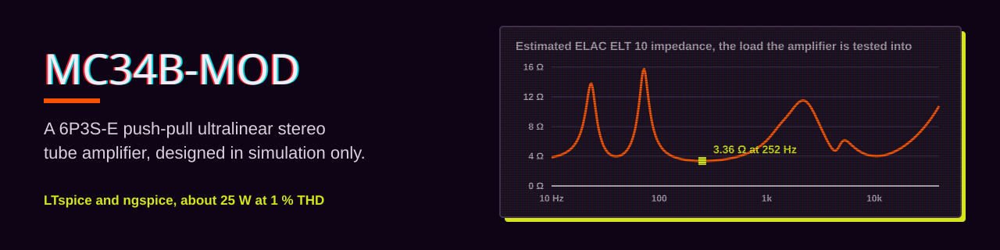
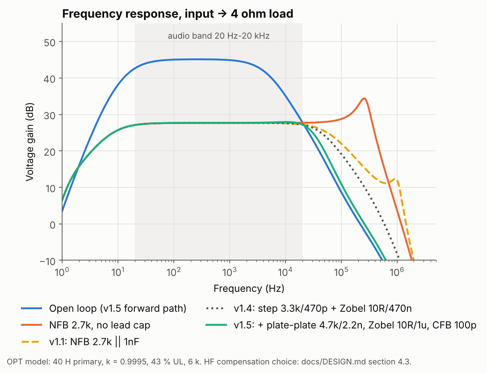
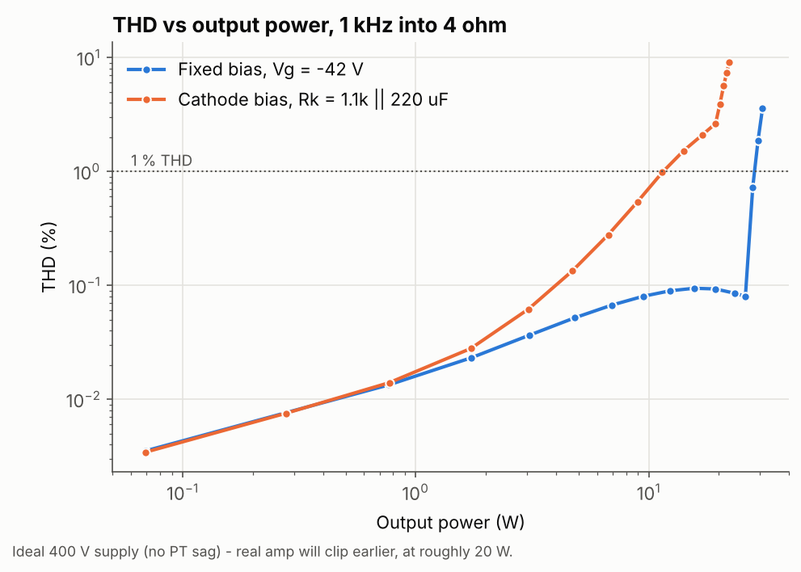
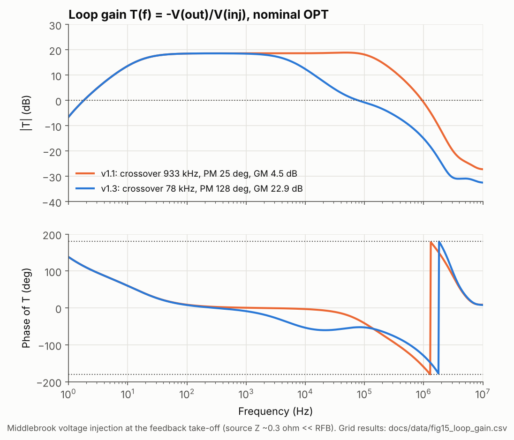
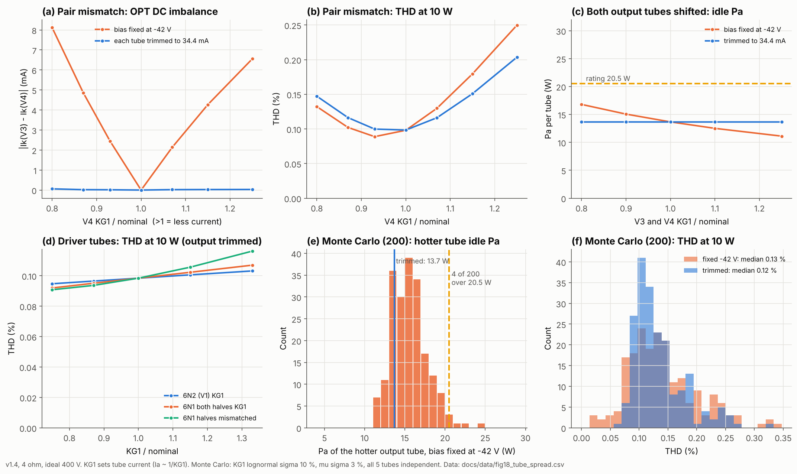
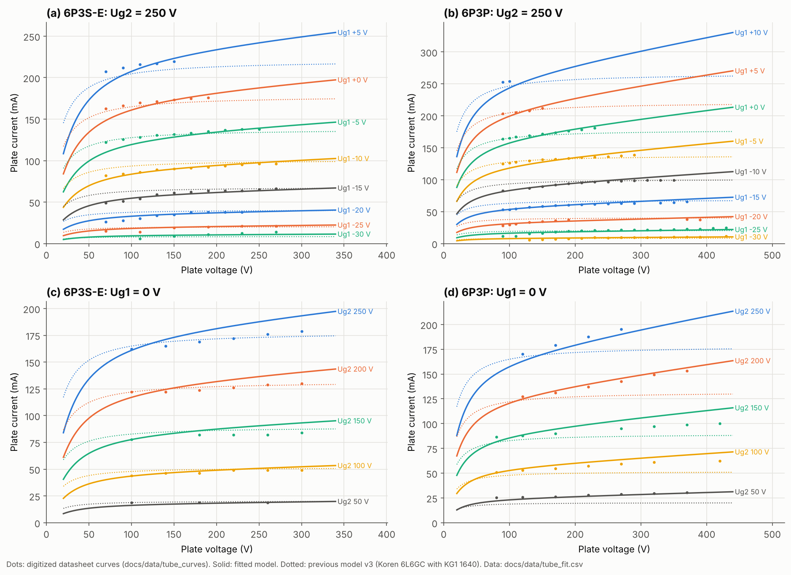

<p align="center">
  <picture><source media="(prefers-color-scheme: dark)" srcset="assets/banner-dark.svg"></picture>
</p>

# mc34b-mod

**English** · [繁體中文](README.zh-TW.md)

> **Simulation only.** Taking the transformer specifications of the Ming-Da MC34-B as given, this repo designs and verifies, in LTspice / ngspice (PSUD2 to follow), a
> **6P3S-E push-pull ultralinear (UL), fixed-bias** stereo tube amplifier driving an **ELAC ELT 10** (4 Ω / 91 dB).
> Nothing in this repo describes a physical build.

[](https://github.com/heinricitorgau/mc34b-mod/actions/workflows/ci.yml)


A tube amplifier designed the way a model should be: every part value comes from a netlist, every figure from a script, and every claim from a sweep. The circuit is a 6N2 voltage amplifier, direct-coupled to a 6N1 long-tail pair, driving two 6P3S-E in push-pull. Transformer, output-transformer and speaker values are assumed or estimated, and marked as such.

---

## Results at a glance

### 1. The baseline: 24 W at 1 % THD, 7.6 Hz – 32 kHz

Simulated with an ideal 400 V supply into 4 Ω (baseline v1.5): gain 24.2×, bandwidth 7.6 Hz – 32 kHz, damping factor 11.6, THD 0.28 % at 10 W, about 24 W at 1 % THD, with about 20 dB of feedback. Each output tube idles at 34.4 mA and 13.7 W, about 67 % of its rating. CI re-measures these numbers on every change.

<p align="center"></p>

### 2. Why fixed bias: 24 W instead of 9 W

With fixed bias, distortion stays below 0.33 % up to about 23 W and reaches 1 % at about 24 W. With cathode (self) bias the same stage passes 1 % at about 9 W.

<p align="center"></p>

### 3. An oscillation, found in simulation and designed out

The first compensated version (v1.1) looked fine into 4 Ω and oscillated with no load connected. Loop-gain measurements over a 120-point grid of output-transformer assumptions showed how bad it was, and three revisions fixed it:

| Worst case over 120 OPT variants, 4 Ω | Lowest phase margin | Lowest gain margin |
|---|---|---|
| v1.1 | 0° | −12.1 dB |
| **v1.5** | **50°** | **37.7 dB** |

The cost is stated too: bandwidth fell from 47 kHz to 32 kHz, and with a purely capacitive 2 µF load the gain margin is only 2.7 dB.

<p align="center"></p>

### 4. Tested against a real supply, mains swings and 200 mismatched tube sets

- **Supply sag:** with both channels at full load, B+ sags from 400 V to about 379 V and power at 1 % THD drops from about 24 W to about 21 W per channel.
- **Mains +10 %:** with the bias held fixed, plate dissipation reaches 21.0 W, above the 6P3S-E's 20.5 W rating; with the bias taken from the same transformer it reaches only 17.0 W. So the bias has to follow the mains.
- **Tube spread:** across 200 simulated amplifiers, per-tube bias adjustment turns out to be necessary, and each tube needs a range of at least −36 V to −50 V.

<p align="center"></p>

### 5. Tube models fitted to datasheet curves, with their limits stated

The power-tube models are fitted to digitized datasheet plate curves (91 points for the 6P3S-E, 129 for the 6P3P) rather than scaled from a 6L6GC. That made the predicted distortion about 3× higher than the earlier single-point models, and the write-up says so; the result is sensitive to the cutoff region, where the datasheet is least readable.

<p align="center"></p>

---

## Quick start

Open `simulations/ltspice/amp_channel_v1.cir` in LTspice and press **Run**, or check the whole baseline from the command line with [ngspice](https://ngspice.sourceforge.io/) (38 or later):

```bash
pip install numpy matplotlib
python tools/ci_check.py            # netlists, schematic, headline numbers, stability: about 30 s
python tools/make_figures.py fig4   # regenerate one figure
```

---

## Documentation

| | |
| --- | --- |
| [**Design and simulation results**](docs/DESIGN.md) | Goals, topology, assumptions, the v1.5 design values and all ten studies: supply, sensitivity, stability, speaker load, tube spread, bias supply, winding capacitance, tube fit, core saturation |
| [**Running the simulations**](docs/USAGE.md) | Directory layout, each netlist and its parameters, regenerating figures, commit conventions |
| [Power supply and PSUD2 table](simulations/psud2/README.md) | The supply on its own |
| [To-do](TODO.md) · [Contributing](CONTRIBUTING.md) | What is still open, and how to propose a change |

---

## Citation

To cite this work, use GitHub's **Cite this repository** button, which reads [`CITATION.cff`](CITATION.cff).

## License

[MIT](LICENSE).
