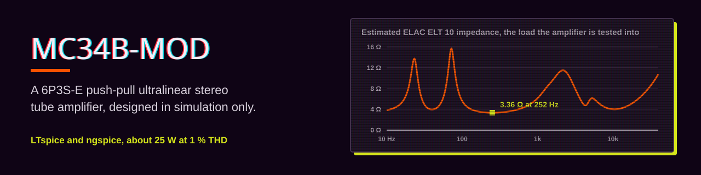
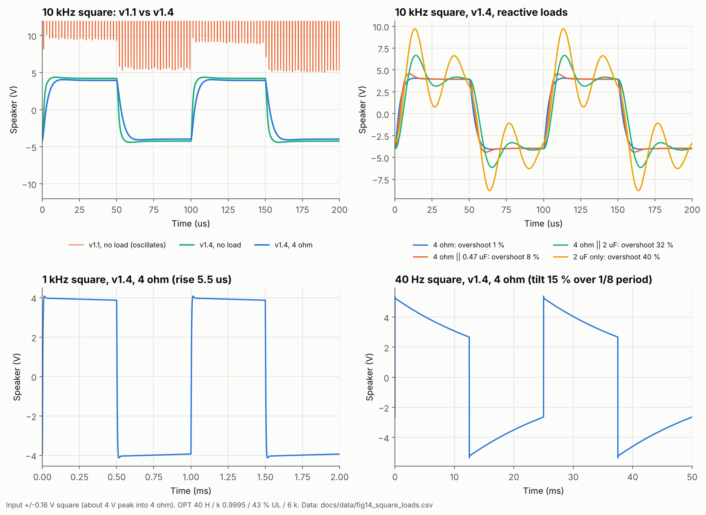
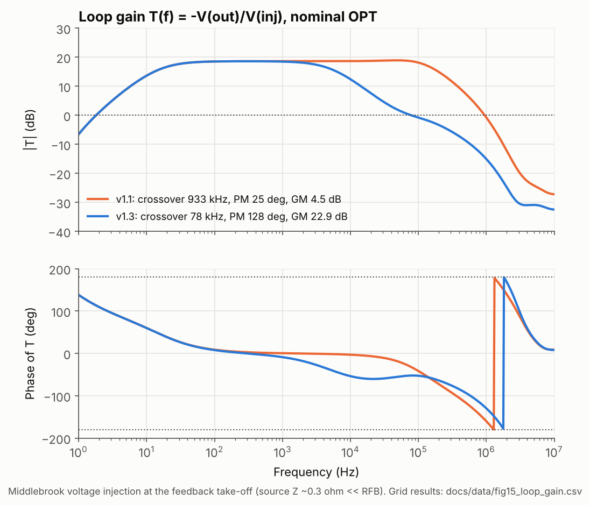
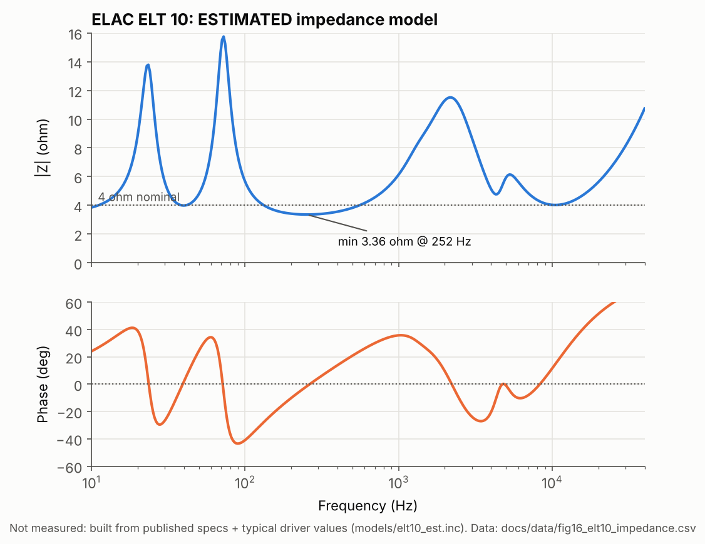
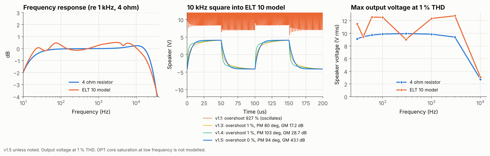
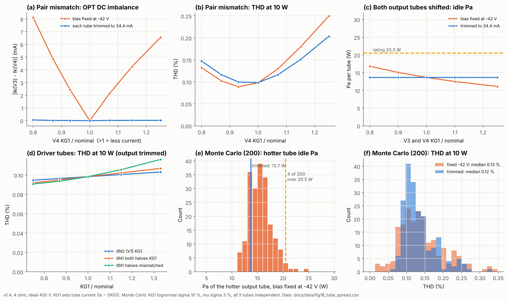
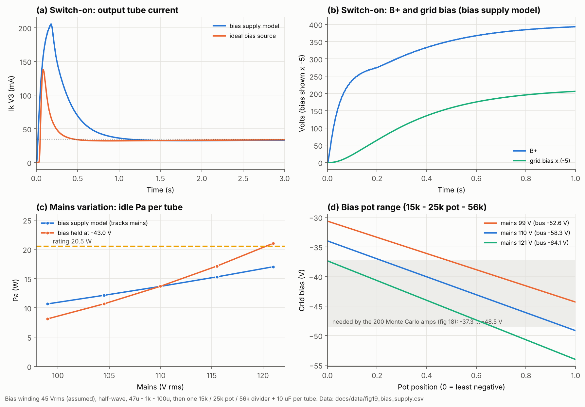
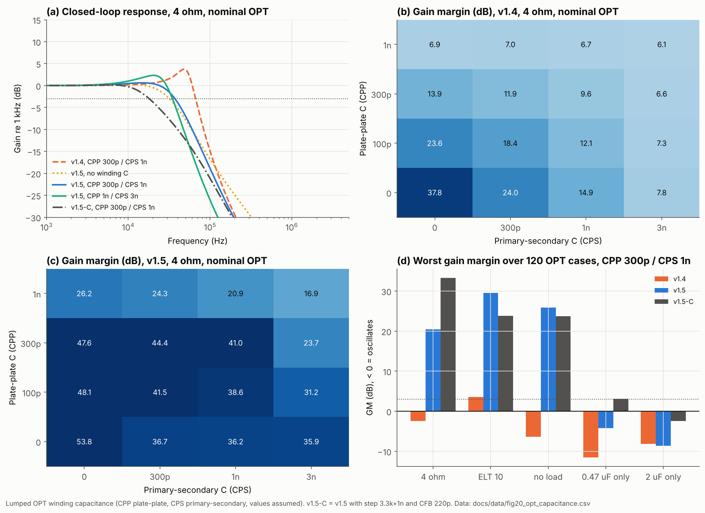
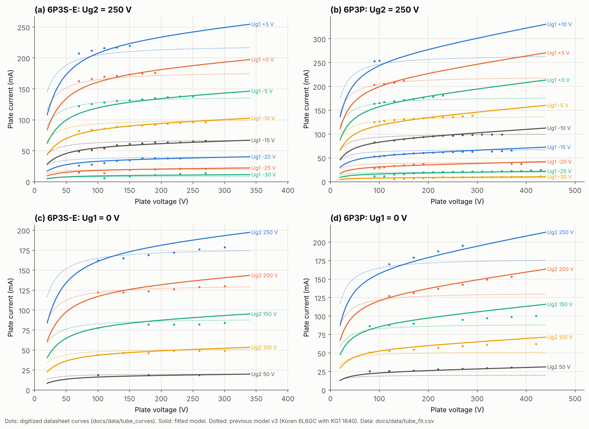
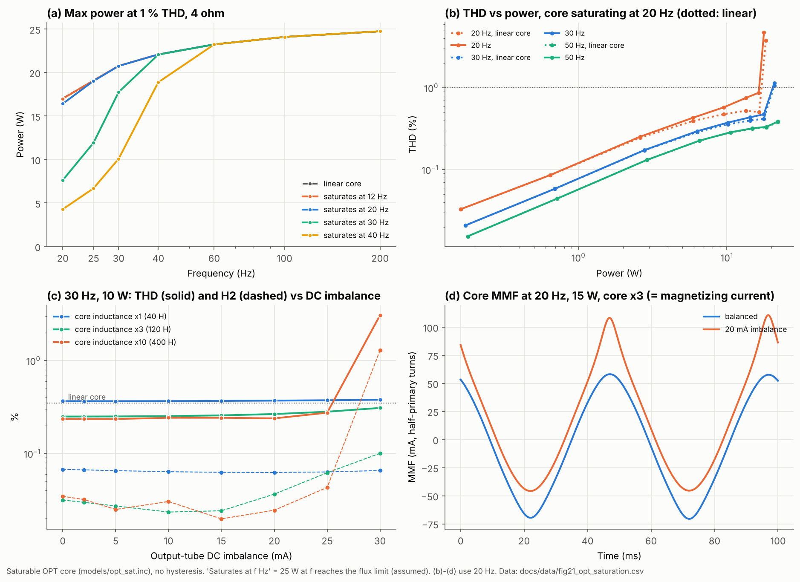

<p align="center">
  <picture><source media="(prefers-color-scheme: dark)" srcset="assets/banner-dark.svg"></picture>
</p>

# mc34b-mod

**English** · [繁體中文](README.zh-TW.md)

> **Simulation only.** Taking the transformer specifications of the Ming-Da MC34-B as given, this repo designs and verifies, in LTspice / ngspice (PSUD2 to follow), a
> **6P3S-E push-pull ultralinear (UL), fixed-bias** stereo tube amplifier driving an **ELAC ELT 10** (4 Ω / 91 dB).
> Nothing in this repo describes a physical build.

| Item | Status |
|---|---|
| SPICE models | ✅ v4 (6N1 / 6N2 fitted; 6P3S-E and 6P3P each fitted to multiple points of their datasheet curves, §4.9) |
| Mono LTspice netlist | ✅ v1.5 (ideal 400 V supply, with high-frequency compensation); schematic `amp_channel_v1.asc` |
| Power supply model (PSUD2 / SPICE) | ✅ psu_v1: SPICE version done; PSUD2 input table in `simulations/psud2/`, `.psu` file not yet saved |
| Stereo + power supply simulation | ✅ `amp_stereo_psu_v1.cir` |
| Simulation figures | ✅ 22 figures (`docs/figures/`), raw data in `docs/data/` |
| Square wave / loop stability | ✅ see §4.4 |
| B+ / OPT sensitivity | ✅ see §4.3 (found a high-frequency resonance; compensation added from v1.3) |
| ELT 10 speaker load (estimated model) | ✅ see §4.5 (v1.4 re-chose the compensation from it) |
| Tube spread sensitivity | ✅ see §4.6 |
| Bias supply model | ✅ see §4.7 |
| OPT winding capacitance, purely capacitive load | ✅ see §4.8 (v1.5 re-chose the compensation from it) |
| OPT core saturation | ✅ see §4.10 (a separate OPT model, `opt_sat.inc`; the baseline netlist still uses a linear core) |
| Power tube multi-point datasheet fit | ✅ see §4.9 (`tools/fit_tubes.py`) |

---

## 1. Simulation goals

- **Check that a push-pull stage can drive a 4 Ω load.** The ELT 10 is a two-way speaker with two 6.5" woofers in parallel, a 4 Ω load that needs low output impedance and plenty of current, so the design simulates push-pull rather than single-ended.
- **Use the MC34-B transformer specifications as boundary conditions.** B+ and OPT parameters are typical assumed values (see §3) used as simulation inputs.
- **Make every circuit change reproducible.** Models, netlists and the figure scripts all live in the repo and are tracked in Git.

## 2. Circuit topology

```
            ┌──────────── global NFB  RFB 2.7k ∥ 100pF (4Ω tap → V1 cathode) ────────────┐
            │                                                                              │
 IN ──► V1 6N2(½) ─direct─► V2 6N1 long-tail pair ─0.22µF─► V3/V4 6P3S-E ×2 ──► OPT 6k:4Ω ──► 4 Ω
        voltage amp          phase splitter / driver        push-pull UL, fixed bias   (UL taps)
```

- **V1 – 6N2 (one half)**: high-μ voltage amplifier. Its plate is direct-coupled to the long-tail pair's grid (Mullard 5-20 style), which saves a coupling capacitor and gives better low-frequency phase margin.
- **V2 – 6N1 long-tail pair**: low internal resistance and high current, giving about ±40 V of drive swing at the 6P3S-E grids.
- **V3/V4 – 6L6-family push-pull**: UL connection, class AB1, fixed bias.

### 2.1 Tube models used

| Position | Model (`models/tubes_amp.inc`) | Role | Notes |
|---|---|---|---|
| V1 | `6N2` | Input voltage amplifier | Fitted to the 6N2P datasheet typical point |
| V2 | `6N1` ×2 sections | Long-tail phase splitter / driver | Fitted to the 6N1P datasheet typical point |
| V3, V4 | `6P3S-E` (also `6P3P`) | Push-pull power output | Koren beam-tetrode form plus a plate-voltage slope term, fitted to multiple points of the datasheet curves (§4.9); `KG1` can model brand / sample spread |

## 3. Simulation assumptions

| Item | Assumed value | Netlist parameter |
|---|---|---|
| B+ (mono netlist) | Ideal 400 V source with 15 Ω in series | `VBP`, `RBP` |
| B+ (stereo netlist) | `psu_v1`: HT 315.5 Vrms, 40 Ω source resistance, silicon bridge, 220 µF–47 Ω–470 µF | `VSEC`, `RSEC`, `CIN`, `RFIL`, `COUT` |
| Mains | 110 V / 60 Hz (`MAINS` = 0.9–1.1) | `MAINS` |
| Fixed bias (mono netlist) | Ideal −42.9 V source (set for 34.4 mA per tube) | `VB`, `DVB` |
| Fixed bias (stereo netlist) | 45 Vrms bias winding → half-wave → 47 µF–1 kΩ–100 µF → per tube a 15 k / 25 k pot / 56 k divider (§4.7) | `VBIASW`, `WA`, `WB` |
| OPT primary impedance | 6 kΩ plate-to-plate | Set by the turns ratio (`LH`, secondary inductance) |
| OPT primary inductance | 40 H (10 H per half) | `LH=10` |
| UL tap | 43 % | `TU=0.43` |
| Coupling coefficient | 0.9995 (0.998 also tested) | `KC` |
| OPT winding capacitance | Unknown; left out of the netlist by default (1 pF). §4.8 sweeps plate-to-plate 0–1 nF and primary-to-secondary 0–3 nF; typical estimates 300 pF / 1 nF | `CPP`, `CPS` |
| Load | 4 Ω resistor (plus an estimated ELT 10 model, §4.5) | `RL`, `SPK` |

## 4. Design values (simulation baseline v1.5)

| Stage | Part | Value | Simulated operating point |
|---|---|---|---|
| Supply | RD1 / CD1 | 1 k / 47 µF | B2 ≈ 388 V |
| | RD2 / CD2 | 47 k / 47 µF | B3 ≈ 358 V |
| V1 6N2 | RA1 | 330 k | Va ≈ 141 V (to cathode), Ia 0.65 mA |
| | RK1 (unbypassed) | 100 Ω | Feedback injection point |
| | Step network RST + CST | 3.3 k + 470 pF (6N2 plate to ground) | Lowers loop gain around 1 MHz (from v1.3) |
| | RK2 ∥ CK2 | 2.7 k ∥ 220 µF | Vgk ≈ −0.9 V (RFB is in parallel with RK2 at DC, already included) |
| V2 6N1 LTP | RT (tail) | 15 k | Vk ≈ 144 V, 9.8 mA total |
| | RLA / RLB | 18 k / 18.82 k | Va ≈ 301 V (156 V plate to cathode), 4.9 mA per side, Vgk −2.5 V |
| | Coupling capacitor | 0.22 µF | |
| V3/V4 | Bias VB | −42.9 V | Ik ≈ 34.4 mA, Pa ≈ 13.7 W |
| | Grid leak / grid stopper | 100 k / 1.5 k | |
| | Screen resistor | 1 k (UL tap → G2) | |
| | RKO | 1 Ω | Used to read cathode current in simulation: the value of V(ka) = current (A) |
| NFB | RFB ∥ CFB | 2.7 k ∥ 100 pF (1 nF in v1.1–v1.3, none in v1.4) | About 20 dB of feedback |
| Output | Zobel RZ + CZ | 10 Ω + 1 µF (across the output) | Together with the step network, suppresses loop resonance in the MHz range |
| | Plate-to-plate RC (RPZ + CPZ) | 4.7 kΩ + 2.2 nF (V3 plate ↔ V4 plate) | Suppresses the high-frequency resonance caused by OPT winding capacitance (v1.5, §4.8) |

**Simulated results (v1.5, v4 tube models)**: gain 24.2×, bandwidth 7.6 Hz – 32 kHz (+0.2 dB at 10 kHz, −0.5 dB at 20 kHz), damping factor 11.6, THD 0.28 % at 10 W 1 kHz, about 24 W at 1 % THD, full-power sensitivity about 0.41 Vrms.
(Ideal 400 V supply; for both channels at full load on the supply model see §4.2. Distortion is about 3× higher than the earlier figures; this comes from switching the power tube models to a multi-point datasheet fit and is sensitive to how the cutoff region is fitted, §4.9.)

> **v1.1 fix (2026-11-02)**: the front-end operating points listed in v1 were measured with the feedback resistor removed (open loop). With RFB connected, it sits in parallel with the 6N2 cathode at DC through the OPT secondary, which made the bias shallower, to −0.7 V. RK2 was changed from 1.5 k to 2.7 k, bringing the bias back to −0.9 V; gain, bandwidth, distortion and power are unchanged.
>
> **Why idle plate dissipation is about 14 W rather than 15–17 W**: with the bias held fixed, raising the simulated B+ from 400 V to 420 V raises plate dissipation from 13.6 W to 18.2 W (§4.3). Setting it to about 16 W at 400 V would, at the same ratio, give about 21.4 W at 420 V, above the 6P3S-E's 20.5 W rating.

### 4.1 Simulation figures

Every figure is generated by `tools/make_figures.py` from `models/tubes_amp.inc` and `simulations/ltspice/amp_channel_v1.cir` (ngspice). Rerun it after changing the circuit to update them.

#### Operating points per stage

| V1 – 6N2 | V2 – 6N1 long-tail pair |
|---|---|
|  |  |
| 330k load line, Q point 141 V / 0.65 mA, bias about −0.9 V. It is direct-coupled to the long-tail pair, so the plate voltage is kept deliberately low. | 156 V / 4.9 mA per side, bias −2.5 V, far from the plate dissipation limit. |


V3/V4 – 6P3S-E: idle point 397 V / 34.4 mA (13.7 W, about 67 % of rating, grid −42.9 V), class B load line Raa/4 = 1.5 kΩ.

#### Frequency response and negative feedback


Open loop is about 47 dB; with the 2.7 kΩ feedback resistor it is about 28 dB (about 20 dB of feedback). With only the feedback resistor and no compensation there is a clear peak near 300 kHz. v1.1 removed that peak with a 1 nF phase-lead capacitor in parallel, but a resonance remained near 1 MHz (dashed line). v1.4 uses a step network on the 6N2 plate plus an output Zobel instead of the phase-lead capacitor, with 47 kHz bandwidth; v1.5 adds a plate-to-plate RC, which lowers the bandwidth to 32 kHz in exchange for stability against OPT winding capacitance (§4.8). The progression is in §4.3, §4.5 and §4.8.

#### Distortion and output power: fixed bias vs. cathode bias


With fixed bias, THD stays below 0.33 % up to about 23 W (about 0.28 % at 10 W) and reaches 1 % (clipping) at about 24 W; with cathode (self) bias it passes 1 % at about 9 W. This is the main reason the design uses fixed bias.

#### Waveforms and drive headroom


At about 19 W output, the grid swing of both power tubes is about −83 to −3 V and never goes positive, so the 6N1 long-tail pair still has drive headroom.

#### Bias sweep


In the model, −42.9 V gives 34.4 mA; at about −38 V the tubes hit the 20 W plate dissipation limit.

> ⚠️ Model limits: the figures in §4.1 use an ideal 400 V supply; results with supply sag are in §4.2. The 6P3S-E model is fitted to the datasheet curves, with larger errors in the cutoff region and near the knee (§4.9), and the OPT and transformer parameters are assumed values.

### 4.2 Power supply simulation (psu_v1)

The supply circuit, the PSUD2 input table and sweeps of the supply on its own are in [`simulations/psud2/README.md`](simulations/psud2/README.md).
This section shows the results with the supply connected to two complete channels (`amp_stereo_psu_v1.cir`).

#### Power-on transient


B+ and B2 settle in about 1 second; B3 (the 6N2 supply) takes 5–6 seconds, because RD2 × CD2 = 2.2 s. About 0.2 s after power-on the power tube current spikes to about 205 mA: as B2 rises it pushes the power tube grids positive through the coupling capacitors, while the bias supply takes about 1 second to come up (§4.7). The model assumes the tubes conduct from t = 0, which is the worst case.

#### Ripple and hum


Ripple on C1 is about 4.8 V p-p, leaving about 0.23 V p-p on B+ after the CRC filter. Push-pull cancels B+ ripple almost completely: with matched tubes only 0.30 µV rms reaches the speaker; with one tube drawing 5 % less current it rises to 8.6 µV rms, still about 121 dB below 25 W. (Only hum from supply ripple and bias ripple is counted.)

#### Distortion and sag


With both channels at full load, B+ sags from 400 V to about 379 V, and the power at 1 % THD drops from about 24 W to about 21 W per channel; distortion before clipping is about 0.2–0.5 %, slightly higher than with an ideal supply.

#### Mains ±10 %: does the bias track it?

| Mains | Bias | B+ | Ik per tube | Pa per tube |
|---|---|---|---|---|
| 99 V | Bias supply model (−39.0 V) | 362 V | 29.6 mA | 10.7 W |
| 99 V | Fixed −43.0 V | 367 V | 22.2 mA | 8.1 W |
| 110 V | −43.0 V | 400 V | 34.4 mA | 13.7 W |
| 121 V | Bias supply model (−47.2 V) | 438 V | 39.1 mA | 17.0 W |
| 121 V | Fixed −43.0 V | 431 V | 49.2 mA | **21.0 W** |

The bias comes from a winding on the same transformer (§4.7), so it grows with the mains: at mains +10 % plate dissipation only reaches 17.0 W. With the bias held fixed it would reach 21.0 W, above the 6P3S-E's 20.5 W rating. So the bias has to follow the mains, which is what the bias supply model in the stereo netlist does.

> **v1.2 (2026-11-02)**: replaces the v1.1 estimate of "18.7 W plate dissipation at B+ 420 V". That was an ideal supply with fixed bias and is now superseded by the table above (real supply). The table has been recalculated with the bias supply model and the v4 tube models.

### 4.3 B+ and OPT sensitivity

Parameters that can be varied in the mono netlist (ideal B+): `VBPLUS` (B+), `RAA` (OPT primary impedance), `TU` (UL tap), `LH` (inductance of half the primary; total = 4 × LH), `KC` (coupling coefficient). All data is in `docs/data/*.csv`.

#### B+ 360–440 V


| | Bias fixed at −42.9 V | Bias scaled with B+ |
|---|---|---|
| Idle plate dissipation, 360 → 440 V | 7.0 → **23.7 W** (above 20.5 W from about 429 V) | 10.4 → 17.5 W |
| Maximum power at 1 % THD | 18.2 → 30.7 W | 18.5 → 30.9 W |
| THD at 10 W | 0.71 → 0.10 % | 0.34 → 0.22 % |

Maximum power is set almost entirely by B+ (about +1.6 W per 10 V), whatever the bias scheme. The bias scheme decides whether idle dissipation is safe, and the distortion: the higher the idle current, the lower the crossover distortion (with fixed bias, a low B+ drops the idle current to 19 mA and distortion at 10 W rises to 0.7 %). The conclusion matches the mains sweep in §4.2: the bias has to follow B+.

#### OPT primary impedance × UL tap


- **Results are flat across 5–6.6 kΩ primary impedance (the likely MC34-B range)**: at 43 % UL, maximum power 24.2–24.3 W, distortion at 10 W 0.26–0.31 %, damping factor 10.6–12.2. Whether the OPT is really 5 k or 6.6 k makes little difference to the design.
- **The UL tap matters more than the primary impedance**: a lower tap is closer to pentode connection and gives more power (20 %: about 28–32 W; 55 %: about 20–21 W), and, because open-loop gain is higher and feedback deeper, lower distortion as well.
- Damping factor rises mainly with primary impedance (4 k: about 9.5; 8 k: about 13.3); the UL tap has little effect. Higher primary impedance also gives lower distortion (4 k → 8 k: 0.37 → 0.23 %, 43 % UL).
- With the v1.5 high-frequency compensation, none of these 20 combinations has a high-frequency peak above +0.4 dB.

#### OPT primary inductance and leakage: feedback stability


- **Low frequencies**: with 10–80 H primary inductance the −3 dB lower limit is 7–11 Hz, with no low-frequency peak at all; the low end is very stable.
- **High frequencies (v1.5)**: the −3 dB upper limit is 26–32 kHz. The larger the leakage inductance, the more pronounced the resonance between the plate-to-plate RC and the leakage: 80 mH leakage (k = 0.999, or 80 H primary) gives +1.4 dB near 18 kHz; 160 mH leakage (k = 0.998) gives **+4.5 dB** near 17 kHz. At the baseline 40 mH leakage (k = 0.9995) it is only +0.2 dB.

**How the high-frequency stability was decided**

In v1.1 (feedback 2.7 k ∥ 1 nF only), the loop had a narrow resonance near 1 MHz that some OPT combinations pushed above 0 dB, meaning close to oscillation. For example, with 20 H primary inductance there is **+12.6 dB** at 1.41 MHz (middle dashed line in the figure above). The real OPT parameters are unknown, so the compensation has to work for every plausible OPT. The method was to find the worst case of each compensation scheme over a grid of OPT parameters:

| Compensation | Worst high-frequency peak, 120-point grid | Bandwidth (−3 dB) |
|---|---|---|
| None (v1.1) | **+19.5 dB** | 61 kHz |
| Zobel 4.7 Ω + 100 nF only | **+11.8 dB** | 61 kHz |
| CFB changed to 470 pF only | **+25.3 dB** | 131 kHz |
| 6N2 plate step network 4.7 k + 470 pF only | +4.6 dB | 29 kHz |
| Step network 4.7 k + 470 pF + Zobel | −0.1 dB | 30 kHz |

A dense 1440-point grid (primary impedance 4–8 k, UL 20–55 %, primary inductance 16–60 H, coupling coefficient 0.998–0.9998) was then used to compare several step networks (all with the Zobel):

| Step network | Worst peak above 100 kHz | Worst bump 5–100 kHz | Response at 20 kHz |
|---|---|---|---|
| 4.7 k + 220 pF | −0.3 dB (too little margin) | +0.33 dB | −0.8 dB |
| 4.7 k + 470 pF | −0.7 dB | +0.31 dB | −1.65 dB |
| **3.3 k + 470 pF (v1.3)** | **−9.2 dB** | +0.47 dB | −1.5 dB |
| 2.2 k + 470 pF | −9.3 dB | +0.64 dB | −1.4 dB |
| 6.8 k + 330 pF | **+18.8 dB** | +0.23 dB | −1.25 dB |

The results are sensitive to part values (6.8 k + 330 pF is worse, not better), so v1.3 chose **3.3 kΩ + 470 pF**, which has a large margin and a small 5–100 kHz bump, together with an output Zobel of 4.7 Ω + 100 nF. The cost is bandwidth, down from about 61 kHz to about 31 kHz (−1.5 dB at 20 kHz).

> The model does not include OPT winding capacitance, so the frequency and height of the resonance are only indicative. The conclusion is that "this loop needs high-frequency compensation, with enough margin over the OPT parameters".

> **v1.3 (2026-11-03)**: added a 6N2 plate step network of 3.3 kΩ + 470 pF (`RSTEP`, `CSTEP`) and an output Zobel of 4.7 Ω + 100 nF (`RZOB`, `CZOB`). The two tables above are the v1.3 selection process, which at the time considered only the 4 Ω load.
>
> **v1.4 (2026-11-03) supersedes v1.3**: with the ELT 10 model connected, v1.3 turned out to be unstable for some OPT combinations, so the Zobel became 10 Ω + 470 nF and the 1 nF phase-lead capacitor was removed; see §4.5.
>
> **v1.5 (2026-11-04) supersedes v1.4**: once OPT winding capacitance was added, v1.4 was unstable, so v1.5 adds a plate-to-plate RC of 4.7 kΩ + 2.2 nF, a Zobel of 10 Ω + 1 µF and CFB of 100 pF; see §4.8. The two tables above are the selection process of that time (old 6P3S-E model), kept as a record.

### 4.4 Square-wave response and loop stability

#### Square wave



Input is a ±0.16 V square wave (about 4 V peak across 4 Ω), with the baseline OPT assumptions.

- **10 kHz, 4 Ω**: v1.5 overshoots 6.9 % with a 9.0 µs rise time (consistent with the 32 kHz bandwidth; v1.4 was 1.2 % / 6.6 µs).
- **v1.1 oscillates with no load connected** (orange trace, top left); v1.5 stays clean with no load (3.6 % overshoot).
- **1 kHz**: 8.8 µs rise time, 0.6 % tilt across the flat top.
- **40 Hz**: the flat top tilts 15 % over 1/8 of a period (the second half of the half-period), consistent with the 7.4 Hz low-frequency corner (a first-order high-pass gives about 13.5 % in theory); no low-frequency oscillation. (Square waves below 5 kHz use 1 µs edges: 20 ns edges can stall the 6N2 model's time step in ngspice; this makes the 1 kHz rise time slightly larger.)

#### Loop gain and phase margin



Loop gain T(f) is measured with Middlebrook voltage injection at the feedback sampling point (speaker terminal → RFB). Midband loop gain is about 18.5 dB (about 20 dB of feedback).

**Different loads (baseline OPT)**: phase margin / gain margin, with 10 kHz square-wave overshoot in parentheses

| Load | v1.1 | v1.3 | v1.4 | **v1.5** |
|---|---|---|---|---|
| 4 Ω | 33° / 6.1 dB (0 %) | 126° / 24.8 dB (0 %) | 88° / 37.8 dB (1 %) | **77° / 53.8 dB (7 %)** |
| 8 Ω | 4° / 0.5 dB (6 %) | 116° / 21.6 dB (0 %) | 86° / 34.4 dB (2 %) | **78° / 49.9 dB (5 %)** |
| 4 Ω ∥ 0.47 µF | 10° / 2.6 dB (2 %) | 103° / 27.0 dB (0 %) | 75° / 22.2 dB (6 %) | **71° / 49.7 dB (11 %)** |
| 4 Ω ∥ 2 µF | 33° / 11.1 dB (1 %) | 72° / 37.0 dB (6 %) | 53° / 19.0 dB (32 %) | **53° / 12.4 dB (51 %)** |
| 0.47 µF only | 8° / **−3.5 dB** (14 %) | 52° / 25.4 dB (0 %) | 35° / 10.3 dB (50 %) | **59° / 10.7 dB (32 %)** |
| 2 µF only | 25° / 9.1 dB (2 %) | 42° / 36.7 dB (26 %) | 21° / 10.3 dB (43 %) | **17° / 2.7 dB (30 %)** |
| No load | Oscillates | 77° / 17.2 dB (0 %) | 87° / 27.8 dB (2 %) | **85° / 42.9 dB (4 %)** |

**Different OPTs (4 Ω, worst case over the 120-point grid)**

| | Lowest phase margin | Lowest gain margin |
|---|---|---|
| v1.1 | **0°** | **−12.1 dB** |
| v1.3 | 35° | 5.6 dB |
| v1.4 | 71° | 20.9 dB |
| **v1.5** | **50°** | **37.7 dB** |

(Neither table includes OPT winding capacitance; results with it are in §4.8.)

**Conclusion**: v1.1 oscillates with 8 Ω, with small capacitive loads or with no load. v1.5 has large margins with resistive loads, no load and the ELT 10 (see §4.5). The cost is a small margin with purely capacitive loads (no speaker, a capacitor only): with 2 µF alone the gain margin is only 2.7 dB, and adding winding capacitance makes it oscillate (§4.8).

### 4.5 Driving the ELT 10 (estimated impedance model)

#### Speaker model



The ELT 10 has no published impedance curve or driver parameters, so `models/elt10_est.inc` is **an estimated model built from the specifications, not a measurement**:

- Known specifications: two-way bass reflex, 2 × 165 mm woofers in parallel, 25 mm dome tweeter, 2.7 kHz crossover, 4 Ω, 38 Hz – 25 kHz, cabinet 850 × 230 × 310 mm ([HiFi-Wiki](https://hifi-wiki.com/index.php/Elac_ELT_10)).
- Assumed values: each woofer is a typical 8 Ω-class 6.5" driver (Re 6.2 Ω, fs 42.5 Hz, Qts about 0.47, Vas 25 L), 38 L net cabinet volume, port tuned to 40 Hz, a typical 25 mm dome tweeter, and a second-order crossover at 2.7 kHz.
- The woofers are simulated with electro-mechano-acoustic coupling (Bl coupling, both drivers sharing one cabinet and port), not just drawn as a curve.
- Result: two bass impedance peaks at 25 Hz and 70 Hz with a 40 Hz tuning dip; minimum 3.36 Ω at 252 Hz (not below 80 % of nominal); rising to about 11 Ω around the crossover; phase within ±45°. Acoustic output is −3 dB at about 45 Hz and −6 dB at about 38 Hz, matching the 38 Hz lower limit in the specifications.

#### The amplifier driving the ELT 10



- **Frequency response**: within 20 Hz – 20 kHz it deviates −1.1 / +0.5 dB from the 4 Ω resistor, caused by the output impedance (damping factor 11.6) and the ripples in speaker impedance.
- **Maximum output voltage**: follows the speaker impedance. At high-impedance frequencies (60–100 Hz, 1–3 kHz) it reaches 12.3–12.8 Vrms, and about 9.0 Vrms at the low-impedance 300 Hz; into a 4 Ω resistor it is about 9.1–9.9 Vrms. At 10 kHz it drops to 2.7 Vrms (4 Ω, about 2 W) / 3.1 Vrms (ELT 10): the plate-to-plate RC loads the power tubes more heavily at high frequencies (§4.8), and the loop gain at 10 kHz is also lower, so crossover distortion is not suppressed as well.
- **Stability**: the speaker's impedance rises at high frequencies, so to the amplifier it looks close to no load.

| | Baseline OPT: phase margin / gain margin | Worst case over the 120-point OPT grid |
|---|---|---|
| v1.1 | Oscillates (927 % overshoot on a 10 kHz square wave) | Oscillates |
| v1.3 | 80° / 17.2 dB | **0° / −0.8 dB (unstable)** |
| v1.4 | 103° / 28.7 dB | 84° / 14.7 dB |
| **v1.5** | **94° / 43.1 dB** | **76° / 27.8 dB** |

#### Why v1.3 became v1.4

The v1.3 compensation was chosen with a 4 Ω load only. With the ELT 10 connected, 12 of the 120 OPT combinations were unstable, so the compensation was searched again (140 combinations of step network × Zobel × phase-lead capacitor), checking 4 Ω, ELT 10, no load and purely capacitive loads at the same time. The key finding: **the 1 nF phase-lead capacitor raises loop gain in the MHz range**, and removing it is both more stable and wider in bandwidth.

Each cell is the "lowest phase margin / lowest gain margin (number of failing combinations)" over the 120-point OPT grid:

| Scheme | 20 kHz | Bandwidth | 4 Ω | ELT 10 | No load | 0.47 µF only | 2 µF only |
|---|---|---|---|---|---|---|---|
| v1.3: Zobel 4.7 Ω + 100 nF, CFB 1 nF | −1.5 dB | 32 kHz | 30°/5.2 (0) | **1°/−1.6 (12)** | 0°/−1.6 (13) | 12°/6.0 (6) | 6°/17.7 (10) |
| **v1.4: Zobel 10 Ω + 470 nF, no CFB** | **−0.3 dB** | **55 kHz** | 66°/19.8 (0) | **78°/14.1 (0)** | 51°/13.6 (0) | 0°/−1.2 (22) | 3°/−4.7 (42) |
| Alternative E: step 3.3 k + 1 nF, Zobel 10 Ω + 470 nF, CFB 220 pF | −2.5 dB | 23 kHz | 87°/18.9 (0) | 70°/9.7 (0) | 67°/9.3 (0) | 31°/18.6 (0) | 13°/9.4 (5) |

(Every scheme uses a 3.3 kΩ step network; v1.3 and v1.4 use 3.3 k + 470 pF.)

v1.4 is chosen for the ELT 10 that will actually be connected: it has the best bandwidth and 20 kHz response, and large margins with resistors, the speaker and no load. **Known limitation**: a lab test with a capacitor only and no speaker oscillates for some OPT combinations. If stability into arbitrary loads becomes more important later, alternative E can be used instead (bandwidth drops to 23 kHz).

> **v1.4 (2026-11-03)**: Zobel changed from 4.7 Ω + 100 nF to 10 Ω + 470 nF (`RZOB`, `CZOB`), the 1 nF across the feedback resistor removed (`CFB=1p`), step network 3.3 kΩ + 470 pF unchanged. All figures and data regenerated. To connect the ELT 10 model: `SPK=1 RL=1e6`.
>
> ⚠️ The speaker model is an estimate, and the baseline model has no OPT core saturation (winding capacitance is covered in §4.8, core saturation in §4.10). The conclusion is "what compensation and margins this kind of load needs", not exact numbers. The trade-off table in this section is the v1.4 selection process of that time (old 6P3S-E model, no winding capacitance), kept as a record.
>
> **Measured ELT 10 impedance**: no published measured impedance curve or driver T/S parameters have been found yet. Once available (measured or from the manufacturer), change `PARAMS:` in `models/elt10_est.inc` to the fitted values and rerun `python tools/make_figures.py fig16 fig17`.

### 4.6 Tube spread sensitivity



Tubes of the same type differ from one another in current and amplification factor. This is simulated through model parameters:

- **KG1**: sets the tube current (plate current is roughly proportional to 1/KG1). KG1 × 1.25 ≈ 20 % less current.
- **μ**: amplification factor.
- **Per-tube bias adjustment**: the netlist adds `DVB`, so V4's bias can be adjusted separately from V3 (V4 bias = `VB` + `DVB`). "Adjusted" means both power tubes are set to 34.4 mA.

Conditions: v1.5, 4 Ω, ideal 400 V supply, 6P3S-E v4 model. Raw data is in `docs/data/fig18_tube_spread.csv`.

#### A mismatched pair of power tubes (V3 nominal, V4 shifted)

| V4 KG1 / nominal | Fixed −42.9 V bias: current difference | THD at 10 W | Adjusted per tube: current difference | THD at 10 W | DVB needed |
|---|---|---|---|---|---|
| 0.8 (about 25 % more current) | 8.4 mA | 0.25 % | 0.06 mA | 0.29 % | −2.6 V |
| 0.93 | 2.5 mA | 0.26 % | 0.02 mA | 0.28 % | −0.9 V |
| 1.0 (matched) | 0 | 0.28 % | 0 | 0.28 % | 0 |
| 1.07 | 2.2 mA | 0.31 % | 0.01 mA | 0.28 % | +0.8 V |
| 1.25 (20 % less current) | 6.8 mA | 0.41 % | 0.04 mA | 0.30 % | +2.7 V |

- A mismatch sends **DC unbalance current** through the OPT (figure a). Push-pull output transformers are sensitive to this: it biases the core and raises low-frequency distortion. The baseline model here has no core saturation, so only the size of the current can be seen; its effect on low-frequency distortion is in §4.10.
- Per-tube bias adjustment brings the DC unbalance below 0.1 mA; after adjustment distortion returns almost to the matched value (0.28–0.30 %), and the remaining difference comes from the two tubes' different transconductance (figure b).
- With fixed bias the distortion curve is asymmetric: when V4 draws more current (KG1 < 1) distortion is slightly lower, and when it draws less it is clearly higher. Distortion in the v4 model is dominated by crossover distortion, which falls as idle current rises (see the next part).

#### Both power tubes shifted together (new brand, ageing)

| V3, V4 KG1 / nominal | Fixed −42.9 V bias: Ik / Pa per tube | THD at 10 W | Bias needed after per-tube adjustment |
|---|---|---|---|
| 0.8 (higher-current tubes) | 42.7 mA / **16.9 W** | 0.19 % | −45.5 V |
| 0.9 | 38.1 mA / 15.1 W | 0.23 % | −44.1 V |
| 1.0 | 34.4 mA / 13.6 W | 0.28 % | −42.9 V |
| 1.1 | 31.3 mA / 12.4 W | 0.33 % | −41.8 V |
| 1.25 (lower-current tubes) | 27.6 mA / 11.0 W | 0.40 % | −40.2 V |

When both tubes in a channel shift together they stay balanced, and the effect is on idle plate dissipation and distortion (figure c). With fixed bias, tubes with 25 % more current reach 16.9 W, still within the 20.5 W rating; after adjustment all return to 13.7 W. With idle current going from 28 to 43 mA, distortion at 10 W goes from 0.40 to 0.19 %: in the v4 model, idle current is a trade-off between distortion and plate dissipation.

#### Driver tubes (6N2, 6N1)

With the output stage biased, shifting the KG1 of the 6N2 or 6N1 from −25 % to +33 % keeps distortion at 10 W within 0.26–0.30 % (figure d), with gain changing by less than ±1 %. The direct-coupled operating points hold as well:

| Change | 6N2 Vgk | LTP plate-to-cathode voltage | LTP current per side |
|---|---|---|---|
| Nominal | −0.90 V | 156 V | 4.9 mA |
| 6N2 KG1 × 0.75 | −0.93 V | 168 V | 4.7 mA |
| 6N2 KG1 × 1.33 | −0.87 V | 143 V | 5.1 mA |
| Both 6N1 halves KG1 × 1.33 | −0.90 V | 157 V | 4.9 mA |
| 6N1 halves mismatched × 1.33 | −0.90 V | 152 V | 5.1 mA |

The 6N2 is the most sensitive tube in the direct-coupled circuit: its plate voltage sets the long-tail pair's grid voltage, so a 6N2 difference moves the long-tail pair's operating point directly (143–168 V plate to cathode). But the 6N2's bias always stays between −0.86 V and −0.93 V, nowhere near grid current.

#### Monte Carlo: 200 amplifiers

Five tube sections (the 6N2 of V1, the two triode sections of the V2 6N1, V3 and V4) are sampled independently: KG1 log-normal with 10 % standard deviation; μ normal with 3 % standard deviation. Each amplifier is computed twice, "bias fixed at −42.9 V" and "adjusted per tube to 34.4 mA".

| Metric | Bias fixed at −42.9 V | Adjusted per tube |
|---|---|---|
| Idle plate dissipation of the hotter power tube (median / 95 %) | 15.1 W / 18.0 W | 13.7 W |
| Amplifiers above the 20.5 W rating | **1 / 200** (highest 21.3 W) | 0 |
| Amplifiers above 17 W | 24 / 200 | 0 |
| OPT DC unbalance (median / 95 % / max) | 5.0 / 15.2 / 26.6 mA | 0.0 / 0.1 / 0.2 mA |
| THD at 10 W (median / 95 %) | 0.30 % / 0.42 % | 0.29 % / 0.33 % |
| Gain (range) | — | 23.9–24.4× |
| 6N2 Vgk (range) | — | −0.86 to −0.93 V |
| LTP plate-to-cathode voltage (range) | — | 143–172 V |

**Conclusions**

1. **Per-tube bias adjustment is necessary**, mainly for plate dissipation and OPT DC balance; it also narrows the spread of distortion (95 %: 0.42 → 0.33 %). With fixed bias, 1 amplifier in 200 has a power tube above its rated plate dissipation and 24 exceed 17 W; OPT DC unbalance of 5–15 mA is common.
2. **Bias adjustment range**: across the 200 amplifiers each tube needs between −37.3 V and −48.5 V (1–99 % fall within −38.9 to −46.9 V). Each tube's bias adjustment range must cover at least **−36 V to −50 V**.
3. **Power tube matching**: after bias adjustment, a transconductance difference has less effect on distortion (0.28 % → 0.30 % at a 20 % current difference), because distortion in the v4 model is dominated by crossover distortion. Two closely matched tubes per channel are still better (DC balance is easier to maintain).
4. **Driver tubes need no selection**: ±25–33 % differences in the 6N2 and 6N1 have little effect on distortion or gain, and the direct-coupled operating points stay in a safe range.

> Limits: only two parameters, KG1 and μ, are simulated; the OPT in this section has a linear core, and the effect of DC unbalance on low-frequency distortion is covered separately in §4.10.

### 4.7 Bias supply



The stereo netlist's bias used to be "ideal voltage source × mains factor". It is now the actual circuit, written in `psu_v1.cir` and brought into `amp_stereo_psu_v1.cir` by the generator:

- A 45 Vrms bias winding on the power transformer (assumed value), half-wave rectified → 47 µF → 1 kΩ → 100 µF, giving a bias bus (`nbus`) of about −58.5 V with 16 mV p-p ripple.
- One divider per power tube: 15 kΩ → 25 kΩ pot (wiper = grid bias, with 10 µF to ground) → 56 kΩ to ground. The four dividers draw about 2.4 mA in total.
- Pot positions `WA`, `WB` (0 = least negative, 1 = most negative); 0.598 gives 34.4 mA per tube (grid −43.0 V).
- The lower divider resistor was originally 62 kΩ and was changed to 56 kΩ with the v3 tube models (which needed shallower bias). With the v4 models the required range becomes −37.3 to −48.5 V; 56 kΩ still covers it, but leaves only about 0.7 V of margin at the most negative end, while 62 kΩ (−35.6 to −49.9 V) gives more even margins at both ends (1.7 V / 1.4 V).

| Item | Result |
|---|---|
| Adjustment range (110 V mains) | **−34.0 to −49.2 V**, covering the −37.3 to −48.5 V the §4.6 Monte Carlo needs |
| Adjustment range (99 / 121 V mains) | −30.7 to −44.3 V / −37.4 to −54.1 V (the range moves in proportion to the mains, in the same direction as the bias the tubes need) |
| Plate dissipation per tube, mains 99 → 121 V | Bias supply model: **10.7 → 17.0 W**; bias fixed at −43.0 V: 8.1 → **21.0 W** (above rating) |
| Bias ripple | 1.3 mV rms on the bus, 5.6 µV rms at the grid (120 Hz) |
| 120 Hz hum at the speaker | Matched tubes 0.30 µV (ideal bias 0.15 µV); V4 5 % low 8.6 µV (ideal bias 8.9 µV). The bias ripple's contribution is negligible |
| Cold start (tubes conducting from t = 0) | Power tube current surges to **205 mA** at 0.18 s (ideal bias 138 mA) |

- **Tracking the mains**: §4.2 assumed that "the bias comes from the same transformer and follows the mains"; the actual circuit confirms it (17.0 W at 121 V).
- **Power-on spike**: the bias takes about 1 second to come up (the filter capacitors and the 10 µF wiper capacitors have to charge), while B+ reaches 300 V within 0.3 seconds, so for a while the grid bias is not negative enough. The model assumes the tubes conduct as soon as power is applied; in reality the heaters take over ten seconds to warm up, by which time the bias is long established, so a normal power-on does not see this. It can only happen when a warm amplifier is switched off and quickly back on.

### 4.8 OPT winding capacitance and v1.5



A real output transformer has distributed capacitance between its windings, which the models up to v1.4 left out. Here two lumped capacitors are added to the OPT model (`CPP`, `CPS`; default 1 pF = not added):

- **CPP**: between the plates of the two primary halves (V3 plate ↔ V4 plate).
- **CPS**: primary to secondary, split evenly across both ends (half between V3 plate ↔ speaker terminal, half between V4 plate ↔ ground).

The real MC34-B values are unknown, so plate-to-plate 0–1 nF and primary-to-secondary 0–3 nF are swept; **300 pF / 1 nF is taken as the typical estimate** and 1 nF / 3 nF as the harsh case. Raw data is in `docs/data/fig20_opt_capacitance.csv`.

#### The problem with v1.4

As soon as typical winding capacitance is added, v1.4's margins drop sharply (figure b): with the baseline OPT into 4 Ω, gain margin falls from 37.8 dB to 9.6 dB (300 pF / 1 nF) and 6.1 dB (1 nF / 3 nF). Over the 120-point OPT grid it is clearer still:

| v1.4, CPP 300 pF / CPS 1 nF | Lowest phase margin / lowest gain margin (failing combinations / 120) |
|---|---|
| 4 Ω | 2° / **−2.4 dB (14)** |
| ELT 10 | 12° / 3.6 dB (2) |
| No load | 1° / **−6.4 dB (22)** |

(Failing = phase margin < 20° or gain margin < 3 dB; gain margin < 0 dB means it oscillates.)

#### Searching the compensation again

Conditions: feedback resistor fixed at 2.7 kΩ (gain and damping factor unchanged); the worst case over a 36-point OPT grid × winding capacitance {none, 300 pF / 1 nF} × load {4 Ω, none, ELT 10} must have phase margin ≥ 20° and gain margin ≥ 3 dB, and with the baseline OPT plus typical capacitance, 4 Ω and ELT 10 must reach ≥ 45° / 10 dB.

- Adjusting only the step network, Zobel and phase-lead capacitor (180 combinations, including 4.7 k and 6.8 k feedback resistors): **no combination keeps enough margin with both 4 Ω and no load**. The best few still have a lowest gain margin of only 0.3–3.3 dB with no load. The resonance from winding capacitance is on the primary side and is hard to suppress from the secondary.
- With a **plate-to-plate RC** added (a resistor and capacitor in series between the two power tube plates), 30 combinations pass. The one with the best 20 kHz response and large margins becomes **v1.5**:

| | v1.4 | **v1.5** | v1.5-C (purely capacitive loads first) |
|---|---|---|---|
| Step network | 3.3 k + 470 pF | 3.3 k + 470 pF | 3.3 k + 1 nF |
| Across the feedback resistor | — | 100 pF | 220 pF |
| Output Zobel | 10 Ω + 470 nF | 10 Ω + 1 µF | 10 Ω + 1 µF |
| Plate-to-plate RC | — | **4.7 kΩ + 2.2 nF** | 4.7 kΩ + 2.2 nF |
| 20 kHz response / −3 dB bandwidth | −0.5 dB / 47 kHz | **−0.5 dB / 32 kHz** | −4.3 dB / 17 kHz |
| Damping factor | 11.6 | 11.6 | 11.0 |

Worst case over the 120-point OPT grid, CPP 300 pF / CPS 1 nF (lowest phase margin / lowest gain margin (failing combinations)):

| Load | v1.4 | **v1.5** | v1.5-C |
|---|---|---|---|
| 4 Ω | 2° / −2.4 dB (14) | **33° / 20.4 dB (0)** | 56° / 33.3 dB (0) |
| ELT 10 | 12° / 3.6 dB (2) | **57° / 29.5 dB (0)** | 70° / 23.9 dB (0) |
| No load | 1° / −6.4 dB (22) | **31° / 25.9 dB (0)** | 55° / 23.8 dB (0) |
| 0.47 µF only | 4° / −11.5 dB (94) | 1° / −4.3 dB (40) | 21° / 3.1 dB (0) |
| 2 µF only | 1° / −8.1 dB (70) | 2° / −8.6 dB (60) | 0° / −2.5 dB (20) |

In the harsh case of CPP 1 nF / CPS 3 nF, v1.5 into the ELT 10 still has no failing combinations (36° / 21.7 dB), while 4 Ω has 3 and no load has 2; v1.5-C has none with 4 Ω, ELT 10 or no load.

(Both tables are results with the v4 tube models; v1.5 was chosen with the v3 models, and the conclusion is unchanged after switching models.)

#### What v1.5 costs

- **Bandwidth**: 47 kHz → 32 kHz, −0.5 dB at 20 kHz, with a small +0.2 dB bump near 10 kHz.
- **A bump when leakage is large**: the plate-to-plate RC resonates with the OPT leakage inductance, giving +4.5 dB near 17 kHz at 160 mH leakage (k = 0.998) (§4.3). At the baseline 40 mH leakage it is only +0.2 dB.
- **High-frequency power**: at high frequencies the plate-to-plate RC is an extra load on the power tubes. With a 10 W sine output, the 4.7 kΩ resistor dissipates 0.06 W (1 kHz), **4.9 W (10 kHz)** and **11.6 W (20 kHz)** (these numbers are set by the output voltage and were computed with the v3 models); at 10 kHz the maximum output at 1 % THD is about 2 W (4 Ω, §4.5). Music usually has far less high-frequency energy than a full-power sine wave, but full-power high-frequency sine tests need to watch this resistor's dissipation.
- **Purely capacitive loads**: with a capacitor only and no speaker, v1.5 has a small margin (baseline OPT, no winding capacitance, 2 µF only: 17° / 2.7 dB), and adding winding capacitance makes it oscillate.

#### The trade-off for purely capacitive loads

With a capacitor only (no speaker) and winding capacitance present, all three versions can oscillate; making it stable costs bandwidth. v1.5-C (1 nF step capacitor, 220 pF across the feedback resistor) cuts the failing combinations with 0.47 µF only from 40 to 0, but its 20 kHz response drops to −4.3 dB, and 2 µF only still fails in 20 combinations.

This design's load is the ELT 10, whose impedance rises at high frequencies and approaches no load; v1.5 has large margins with that kind of load, so **v1.5 is chosen**. Known limitation: square-wave tests should use a resistive load, never a capacitor alone. If stability into arbitrary loads becomes more important later, v1.5-C (`CSTEP=1n CFB=220p`) can be used instead.

> **v1.5 (2026-11-04)**: added a plate-to-plate RC of 4.7 kΩ + 2.2 nF (`RPZ`, `CPZ`), changed the Zobel to 10 Ω + 1 µF and put 100 pF across the feedback resistor (`CFB`); the 3.3 kΩ + 470 pF step network is unchanged. All figures and data regenerated. By default the netlist adds no winding capacitance (`CPP=1p CPS=1p`), consistent with the other figures; set `CPP=300p CPS=1n` to include it.
>
> ⚠️ The winding capacitance is approximated by two lumped capacitors, while the real thing is distributed, and the values are assumptions. The conclusion is that "this loop is sensitive to winding capacitance and needs primary-side compensation such as a plate-to-plate RC", not an exact oscillation frequency.

### 4.9 Power tube models: multi-point fit to datasheet curves (v4)



v3 only scaled the current to match one operating point of the 6P3S datasheet; the curve shape was still Koren's 6L6GC. v4 uses the full set of plate characteristic curves from the datasheets, fitting the 6P3S-E and 6P3P separately.

#### Data

| Tube | Source | Curves | Points |
|---|---|---|---|
| 6P3S-E | [kutilovo.cz 6P3S / 6P3S-E datasheet](https://www.kutilovo.cz/vincom/sheets/104316.pdf) | Ug2 = 250 V, Ug1 = +5 to −30 V; Ug1 = 0, Ug2 = 50–250 V; Ua up to 320 V | 91 |
| 6P3P | [r-type.org 6P3P (Chinese tube handbook)](https://r-type.org/pdfs/6p3p.pdf) | Ug2 = 250 V, Ug1 = +10 to −30 V; Ug1 = 0, Ug2 = 50–250 V; Ua up to 440 V | 129 |

Both are scanned images. The PDFs were rendered to high-resolution images in a browser, the coordinates calibrated against the grid, and the curve positions read column by column, with a reading error of about 2–3 mA; low-current curves such as −25 V and −30 V are less accurate. Each tube's typical operating point (250 V / 250 V / −14 V, weight ×4) is also included. The digitized data is in `docs/data/tube_curves/`, and the fitting script is `tools/fit_tubes.py`.

#### Model and results

The model keeps Koren's beam-tetrode equations and adds a plate-voltage slope term, `LAM`: the datasheet curves keep rising with plate voltage beyond the knee, which the original equations cannot reproduce (`LAM = 0` is the original form). μ, EX, KG1, KP, KVB and LAM are fitted by least squares on log(Ia); KG2 is set by the screen current.

| | v3 (shared by both tubes) | **6P3S-E v4** | **6P3P v4** |
|---|---|---|---|
| μ / EX | 8.7 / 1.35 | 10.33 / 1.427 | 11.40 / 1.194 |
| KG1 / KG2 | 1640 / 7500 | 1698 / 5510 | 766 / 3998 |
| KP / KVB / LAM | 48 / 12 / 0 | 30.2 / 22.4 / 4.4 × 10⁻⁴ | 37.2 / 18.7 / 7.3 × 10⁻⁴ |
| Error on log-scaled curves (rms) | 12 % (6P3S-E) / 16 % (6P3P) | **9.0 %** | **9.6 %** |
| 250 / 250 / −14 V: Ia | 72.1 mA | 69.8 mA (datasheet 73 ± 13) | 69.9 mA (72 ± 14) |
| Same point: Ig2 / transconductance / plate resistance | 5.0 mA / 6.1 mA/V / — | 5.0 mA / 6.3 mA/V / 23 k | 3.0 mA / 6.6 mA/V / 18 k |

The Python equations and the ngspice subcircuit agree to within 0.01 % at 4 test points (`fit_tubes.py` checks this automatically).

#### Effect on the design

- **Bias**: for the same 34.4 mA the bias goes from −40.9 V to **−42.9 V** (−43.0 V in the stereo netlist on the supply model, pot position 0.598).
- **Higher distortion**: THD at 1 kHz, 10 W goes from 0.09 % to **0.28 %**, mostly added third harmonic (crossover distortion). The cause is KP falling from 48 to about 30: KP sets how the current falls near cutoff, which is exactly where class AB push-pull crosses over.
- **Gain, damping factor**: 24.7 → 24.2×, 13.6 → 11.6 (lower plate resistance).
- **Maximum output**: about 24 W at 1 kHz (previously 25 W). At 10 kHz only about 2 W remains at 1 % THD (about 8 W with the v3 models, §4.5), also because of crossover distortion.

**Distortion is sensitive to how the cutoff region is fitted**: KP is set mainly by the low-current curves from −20 to −30 V, which are exactly the least accurate part of the digitization. Changing the weight of those points (none, ×0.5, ×1, ×2) puts KP between 30 and 40; in the circuit, KP = 30 / 35 / 40 gives about 0.27 / 0.20 / 0.15 % distortion at 10 W and needs about −42.9 / −40.1 / −38.1 V of bias. So the v4 distortion and bias figures are "the order of magnitude the datasheet curves point to", not exact values; better accuracy would need measured curves near cutoff.

#### 6P3S-E vs 6P3P

The two tubes differ very little in this circuit (ideal 400 V supply, each set to 34.4 mA):

| | 6P3S-E | 6P3P |
|---|---|---|
| Bias needed | −42.9 V | −40.6 V |
| THD at 1 kHz: 0.7 W / 7 W / 15 W | 0.045 / 0.23 / 0.32 % | 0.046 / 0.21 / 0.26 % |
| Power at 1 kHz, 1 % THD | 24.2 W | 24.0 W |

The netlist uses the 6P3S-E by default. To switch to the 6P3P, change the model name of `X5` and `X6` to `6P3P`, set `KGA` and `KGB` to 766 (the netlist overrides the model default with `KG1={KGA}`), and change the bias to about −40.6 V.

> Limits: near the knee (plate voltage below 100 V) the error is about 14 % with the model current on the low side, so the clipping power may be slightly conservative; the high-current Ug1 = 0 curve is extrapolated too high at high plate voltage by the slope term. The curves are datasheet typical values, not measurements of individual tubes; sample spread is still modelled with `KG1` and `μ` (§4.6).

### 4.10 OPT core saturation



The OPT in the baseline netlist is a set of linear coupled inductors: the primary inductance is fixed at 40 H and the core never saturates. In a real core the flux grows at low frequencies and large signals, and the inductance falls sharply near saturation; with DC unbalance between the power tubes there is also a fixed DC flux in the core. This section uses a separate OPT model, `models/opt_sat.inc`, to look at both. Raw data is in `docs/data/fig21_opt_saturation.csv`.

#### Model

The OPT is written as a magnetic circuit instead of coupled inductors:

- Each winding's voltage = turns × rate of change of flux, plus its own leakage inductance and copper resistance. Turns ratios, leakage and copper resistance are the same as in the linear model.
- The core's total MMF = the sum of each winding's turns × current. When the two power tubes draw different DC currents, the difference stays in the MMF automatically and becomes a DC flux.
- Flux versus MMF follows a saturation curve: at small signals it behaves as an ordinary inductor, and near the saturation flux `LSAT` the inductance falls sharply (knee sharpness `PSH = 4`).

Validation: with `LSAT` set very large (no saturation), 1 kHz distortion, gain, bandwidth and phase / gain margins match the baseline netlist to 4 decimal places.

The core parameters are all assumed, so they are described by two swept parameters:

| Parameter | Meaning | Sweep range |
|---|---|---|
| Saturation frequency | The frequency at which a 25 W sine wave just brings the flux to `LSAT` | 12, 20, 30, 40 Hz (baseline 20 Hz) |
| Core inductance multiplier `LMUL` | Core inductance at working flux ÷ 40 H. Ungapped silicon-steel laminations often have several times their small-signal permeability at moderate flux | 1, 3, 10× |

Hysteresis and core loss are not modelled.

#### Low-frequency maximum power (figure a, 1 % THD)

| Frequency | Linear core | Saturates at 20 Hz | Saturates at 30 Hz | Saturates at 40 Hz |
|---|---|---|---|---|
| 20 Hz | 17.0 W | 16.4 W | **7.6 W** | **4.3 W** |
| 25 Hz | 19.1 W | 19.0 W | 11.9 W | 6.7 W |
| 30 Hz | 20.8 W | 20.8 W | 17.8 W | 10.1 W |
| 40 Hz | 22.1 W | 22.1 W | 22.1 W | 18.9 W |
| 60 Hz | 23.2 W | 23.2 W | 23.2 W | 23.2 W |
| 100 Hz and above | 24.1–24.7 W | same | same | same |

- Even without saturation, maximum power at 20 Hz is only 17 W: 40 H has about 5 kΩ of reactance at 20 Hz, comparable to the 6 kΩ load, so the power tubes have to supply an extra magnetizing current.
- If the core saturates only below 20 Hz the effect is small; if it saturates at 30–40 Hz, power at 20–30 Hz falls to less than half. The real MC34-B values are unknown; this table can be compared against its stated low-frequency power rating.

#### Low-frequency distortion (figure b, core saturating at 20 Hz)

| | Linear core | Saturates at 20 Hz |
|---|---|---|
| 20 Hz, about 10 W | 0.48 % | **0.58 %** (third harmonic 0.57 %) |
| 20 Hz, about 13 W | 0.52 % | **0.75 %** |
| 30 Hz, about 14 W | 0.40 % | 0.44 % |
| 50 Hz and above | — | within 0.01 % of the linear core |

With the two tubes balanced, saturation is symmetrical, so what is added is mostly third harmonic.

#### DC unbalance (figures c, d; 30 Hz, about 10 W, core saturating at 20 Hz)

| DC unbalance | Inductance ×1 (40 H) | ×3 (120 H) | ×10 (400 H) |
|---|---|---|---|
| 0 | 0.37 % | 0.25 % | 0.24 % |
| 10 mA | 0.37 % | 0.25 % | 0.24 % |
| 20 mA | 0.37 % | 0.27 % | 0.24 % |
| 25 mA | 0.37 % | 0.28 % | 0.27 % |
| 30 mA | 0.38 % | 0.31 % (second harmonic 0.10 %) | **3.1 %** (second harmonic 1.3 %) |

- DC flux = core inductance × DC unbalance, so **the larger the core inductance, the more sensitive it is to DC unbalance**. With multiplier 1, even 30 mA has almost no effect; with multiplier 10 it is fine up to 25 mA, but at 30 mA the DC flux has pushed the core to the edge of saturation and distortion jumps to 3 %, mostly second harmonic.
- Figure d shows the magnetizing current (MMF) waveform: with 20 mA of unbalance the whole waveform shifts upward, the positive half reaches saturation first and becomes peaked while the negative half stays smoother; this is where the second harmonic comes from.
- The larger the core inductance, the lower the low-frequency distortion when balanced (0.37 % → 0.24 %), because the magnetizing current is smaller.
- Compared with §4.6: with fixed, unadjusted bias, 95 % of the 200 amplifiers have OPT DC unbalance within 15 mA and the maximum is 27 mA; after per-tube bias adjustment the maximum is 0.2 mA. By these results, amplifiers with adjusted bias are not affected at all; without adjustment, the few amplifiers with especially large unbalance show clearly higher low-frequency distortion when the core inductance is large.

**Conclusions**

1. Core saturation affects this amplifier only below 40 Hz; it mainly sets the low-frequency maximum power, so the OPT's low-frequency rating (saturation frequency) matters more than its primary inductance.
2. Per-tube bias adjustment (§4.6) also prevents saturation from DC unbalance; with the unbalance trimmed to within 1 mA, no difference is visible under any of the assumptions.
3. The numbers depend on the assumed core parameters; the conclusions are trends and orders of magnitude, not the actual behaviour of the MC34-B.

> How to use: `python tools/make_figures.py fig21` reruns this section and produces a ready-to-use netlist, `simulations/ltspice/amp_channel_v1_sat.cir` (`amp_channel_v1.cir` with `opt_sat.inc` substituted; the parameters `LSAT`, `PSH`, `LMUL` and `IDCX` are in `.param`; `IDCX` is an extra equivalent DC unbalance). This netlist has only been verified in ngspice.

## 5. Directory layout

```
mc34b-mod/
├── .github/                issue and pull request templates
├── assets/                 README banner
├── models/                 SPICE models (tubes_amp.inc), ELT 10 estimated model (elt10_est.inc),
│                           saturable-core OPT (opt_sat.inc)
├── simulations/
│   ├── ltspice/            amp_channel_v1.cir (mono), psu_v1.cir (power supply),
│   │                       amp_stereo_psu_v1.cir (generated, do not edit by hand), curves_*.cir,
│   │                       amp_channel_v1.asc + mc34b_*.asy (schematic, generated),
│   │                       amp_channel_v1_sat.cir (saturable-core version, generated)
│   └── psud2/              PSUD2 input table (README.md) and .psu file
├── docs/
│   ├── figures/            simulation figures (generated by tools/make_figures.py)
│   └── data/               sweep results as CSV (generated with the figures); tube_curves/ holds digitized datasheet curves
├── tools/                  make_figures.py (regenerates docs/figures), make_schematic.py (generates the .asc),
│                           fit_tubes.py (power tube datasheet fit)
├── README.md               this file (English)
├── README.zh-TW.md         Traditional Chinese version
├── TODO.md                 to-do list
├── CLAUDE.md               working notes for Claude / collaborators
├── CONTRIBUTING.md         contributing guide
├── CODE_OF_CONDUCT.md      code of conduct
├── SECURITY.md             security policy
├── LICENSE
└── .gitignore
```

## 6. Running the simulations

1. Open `simulations/ltspice/amp_channel_v1.cir` in LTspice (File → Open, file type All Files) and press **Run**.
2. Add `V(out)` to the waveform window; THD and power results are in **View → SPICE Error Log**.
3. All parameters are in the `.param` block at the top of the netlist. Sweep the bias with `.step param VB list -38 -42 -46`, or the OPT coupling coefficient with `.step param KC list 0.998 0.9995`.
4. For the DC operating point, add `.op` before `.tran`. Plate dissipation = V(pa) × V(ka) (RKO = 1 Ω, so the value of V(ka) is the cathode current).
5. `curves_*.cir` plot each tube's plate characteristics, to check that the models are reasonable.
6. `psu_v1.cir`: the power supply on its own (B+ with a constant-current load, as in PSUD2; the bias bus has an equivalent resistor `RBLOAD`). Change `ILOAD` and `MAINS` to try different scenarios.
7. `amp_stereo_psu_v1.cir`: the supply plus both channels. It is generated from the two files above by `python tools/make_figures.py stereo`; to change the circuit, edit the source files and regenerate. For a cold-start simulation add `.options method=gear` and remove the `.ic` line.
8. Power tube mismatch: in `amp_channel_v1.cir`, `KGA` and `KGB` are the KG1 of the two power tubes; `DVB` is V4's bias offset relative to V3 (per-tube bias adjustment). Parameters for other tubes can be added after the instance, for example `X1 v1a ing v1k 6N2 KG1=1600 MU=95`.
9. Sensitivity: `VBPLUS`, `RAA`, `TU`, `LH` and `KC` are all in the `.param` block of `amp_channel_v1.cir` and can be swept with syntax like `.step param RAA list 5k 6k 6.6k`.
10. To redraw only the sensitivity figures (without rerunning the simulations): `python tools/make_figures.py plot11 plot12`.
11. Load: `RL` is the resistive load (`1e6` = not connected); add a capacitive load with a netlist line such as `CLD out 0 2u`. How loop gain is measured is in `loop_gain()` in `tools/make_figures.py`.
12. To connect the ELT 10 estimated model: `.param SPK=1` and set `RL` to `1e6`. The speaker parameters are in the comments and `PARAMS:` of `models/elt10_est.inc` and can be edited.
13. OPT winding capacitance: `CPP` (plate to plate), `CPS` (primary to secondary, split across both ends); default 1 pF = not added. Example: `.param CPP=300p CPS=1n`. The plate-to-plate RC is `RPZ`, `CPZ` (`RPZ=1e9` = removed, i.e. v1.4).
14. Schematic: open `simulations/ltspice/amp_channel_v1.asc` in LTspice (the `mc34b_*.asy` files in the same folder are the tube and speaker symbols). Every pin is connected to the netlist's node names by net labels, so there are no wires on screen, but the circuit is identical to the `.cir`. It is generated from the `.cir` by `python tools/make_schematic.py`, which also cross-checks every component's nodes; to change the circuit, edit the `.cir` and regenerate.

15. OPT core saturation: `amp_channel_v1_sat.cir`, or `channel(OPT="sat", LSAT=..., LMUL=..., IDCX=...)` in the script (§4.10). For long sweeps, set the environment variable `MF_CACHE=<folder>` to store each ngspice result; rerunning after an interruption skips the parts already done.

16. Power tube fit: `python tools/fit_tubes.py` reads `docs/data/tube_curves/*.csv`, fits, prints the parameters, checks them against the ngspice subcircuit and draws figure 22 (needs scipy). The fitted values have to be written back by hand to `PARAMS:` in `models/tubes_amp.inc`, and the bias readjusted (`VB`, `WA` / `WB`).

**Regenerating the figures** (needs [ngspice](https://ngspice.sourceforge.io/) and Python with numpy and matplotlib):

```powershell
pip install numpy matplotlib
python tools/make_figures.py            # everything
python tools/make_figures.py fig4 fig5  # only some
python tools/make_schematic.py          # regenerate the LTspice schematic
```

## 7. Commit conventions

```
feat(sim):    add / change a simulation
fix(model):   fix a SPICE model
docs(fig):    update figures
docs:         update documentation (README, TODO, CLAUDE.md)
chore:        folders, configuration and other housekeeping
```

## 8. References

- N. Koren, *Improved vacuum tube models for SPICE simulations* (6L6GC parameters)
- Mullard, *Circuits for Audio Amplifiers* (the 5-20 direct-coupled long-tail pair topology)
- [Elac ELT 10 – HiFi-Wiki](https://hifi-wiki.com/index.php/Elac_ELT_10)
- [6P3S – Radiomuseum](https://www.radiomuseum.org/tubes/tube_6p3s.html) (6P3S-E datasheet operating point)
- [6P3S / 6P3S-E datasheet (kutilovo.cz)](https://www.kutilovo.cz/vincom/sheets/104316.pdf) (plate curves used to fit the 6P3S-E)
- [6P3P datasheet (r-type.org, Chinese tube handbook)](https://r-type.org/pdfs/6p3p.pdf) (plate curves used to fit the 6P3P)
