# mc34b-mod

> **純模擬專案。** 以 Ming-Da MC34-B 的變壓器規格為假設條件，在 LTspice / ngspice（之後加上 PSUD2）中設計並驗證一台
> **6P3S-E 推挽超線性 (UL)、固定偏壓** 的立體聲真空管擴大機，負載為 **ELAC ELT 10**（4 Ω / 91 dB）。
> 本 repo 不包含任何實機製作內容。

| 項目 | 狀態 |
|---|---|
| SPICE 模型 | ✅ v2（6N1 / 6N2 擬合、6P3S-E / 6P3P 用 Koren 6L6GC） |
| 單聲道 LTspice 網表 | ✅ v1.3（理想 400 V 電源，含高頻補償） |
| 電源模型（PSUD2 / SPICE） | ✅ psu_v1：SPICE 版完成；PSUD2 輸入表見 `simulations/psud2/`，`.psu` 檔待存 |
| 立體聲 + 電源模擬 | ✅ `amp_stereo_psu_v1.cir` |
| 模擬圖表 | ✅ 13 張（`docs/figures/`），原始數據在 `docs/data/` |
| B+ / OPT 敏感度 | ✅ 見 §4.3（發現高頻共振，v1.3 已加補償解決） |
| 管子離散敏感度 | ⬜ |

---

## 1. 模擬目標

- **驗證推挽架構能否推動 4 Ω 負載**：ELT 10 是二音路、雙 6.5" 低音並聯的 4 Ω 負載，需要低輸出阻抗與足夠電流，因此模擬推挽而不是單端。
- **以 MC34-B 的變壓器規格作為邊界條件**：B+ 與 OPT 參數採用典型值假設（見 §3），作為模擬輸入。
- **每次電路修改都可重現**：模型、網表、圖表產生腳本都放在 repo 中，以 Git 追蹤。

## 2. 電路架構

```
            ┌──────────────── 全域負迴授 RFB 2.7k ∥ 1nF（4Ω 端 → V1 陰極）────────────────┐
            │                                                                              │
 IN ──► V1 6N2(½) ──直耦──► V2 6N1 長尾對 ──0.22µF──► V3/V4 6P3S-E ×2 ──► OPT 6k:4Ω ──► 4 Ω
        電壓放大              倒相 / 驅動              推挽 UL・固定偏壓        (UL 抽頭)
```

- **V1 – 6N2（取半邊）**：高 μ 電壓放大，屏極直接耦合到長尾對柵極（Mullard 5-20 式），少一顆耦合電容，低頻相位裕度較好。
- **V2 – 6N1 長尾對**：低內阻、大電流，提供 6P3S-E 柵極約 ±40 V 的驅動擺幅。
- **V3/V4 – 6L6 家族推挽**：UL 接法，AB1 類，固定偏壓。

### 2.1 使用的管子模型

| 位置 | 模型（`models/tubes_amp.inc`） | 功能 | 備註 |
|---|---|---|---|
| V1 | `6N2` | 輸入電壓放大 | 依 6N2P datasheet 典型點擬合 |
| V2 | `6N1` ×2 單元 | 長尾對倒相 / 驅動 | 依 6N1P datasheet 典型點擬合 |
| V3, V4 | `6P3S-E`（另有 `6P3P`） | 推挽功率輸出 | Koren 6L6GC 參數；可用 `KG1` 模擬廠牌 / 個體差異 |

## 3. 模擬假設條件

| 項目 | 假設值 | 網表中的參數 |
|---|---|---|
| B+（單聲道網表） | 400 V 理想電源，串 15 Ω | `VBP`、`RBP` |
| B+（立體聲網表） | `psu_v1`：HT 315.5 Vrms、內阻 40 Ω、矽橋、220 µF–47 Ω–470 µF | `VSEC`、`RSEC`、`CIN`、`RFIL`、`COUT` |
| 市電 | 110 V / 60 Hz（`MAINS` = 0.9–1.1） | `MAINS` |
| 固定偏壓 | −42 V，立體聲網表中隨市電等比例變動 | `VBN`、`VB` |
| OPT 初級阻抗 | 6 kΩ p-p | 由圈數比決定（`LH`、次級電感） |
| OPT 初級電感 | 40 H（半邊 10 H） | `LH=10` |
| UL 抽頭 | 43 % | `TU=0.43` |
| 耦合係數 | 0.9995（另測 0.998） | `KC` |
| 負載 | 4 Ω 純電阻 | `RLOAD` |

## 4. 設計參數（模擬基準 v1.3）

| 級 | 元件 | 值 | 模擬工作點 |
|---|---|---|---|
| 電源 | RD1 / CD1 | 1 k / 47 µF | B2 ≈ 388 V |
| | RD2 / CD2 | 47 k / 47 µF | B3 ≈ 358 V |
| V1 6N2 | RA1 | 330 k | Va ≈ 141 V（對陰極），Ia 0.65 mA |
| | RK1（不旁路） | 100 Ω | 迴授注入點 |
| | 階梯網路 RST + CST | 3.3 k + 470 pF（6N2 屏極對地） | 降低約 1 MHz 的迴路增益（v1.3） |
| | RK2 ∥ CK2 | 2.7 k ∥ 220 µF | Vgk ≈ −0.9 V（RFB 在直流上與 RK2 並聯，已計入） |
| V2 6N1 LTP | RT（尾電阻） | 15 k | Vk ≈ 144 V，總電流 9.8 mA |
| | RLA / RLB | 18 k / 18.82 k | Va ≈ 301 V（屏陰 156 V），每邊 4.9 mA，Vgk −2.5 V |
| | 耦合電容 | 0.22 µF | |
| V3/V4 | 偏壓 VB | −42 V | Ik ≈ 34.4 mA，Pa ≈ 13.7 W |
| | 柵漏 / 柵阻 | 100 k / 1.5 k | |
| | 簾柵電阻 | 1 k（UL 抽頭 → G2） | |
| | RKO | 1 Ω | 模擬中用來讀陰極電流：V(ka) 的數值 = 電流 (A) |
| NFB | RFB ∥ CFB | 2.7 k ∥ 1 nF | 約 20 dB 迴授 |
| 輸出 | Zobel RZ + CZ | 4.7 Ω + 100 nF（並聯在 4 Ω 輸出端） | 與階梯網路一起壓制約 1 MHz 的迴路共振（v1.3） |

**模擬結果（v1.3）**：增益 24.7 倍、頻寬 7.4 Hz – 31.5 kHz（無峰值，20 kHz 處 −1.5 dB）、阻尼因數 14、約 27 W（0.5 % THD）、全功率靈敏度約 0.42 Vrms。
（理想電源、且 6L6 模型電流偏高約 10 %，此功率為樂觀值。）

> **v1.1 修正（2026-11-02）**：v1 表列的前級工作點是在拔掉迴授電阻（開迴路）時量的。接上 RFB 後，它經 OPT 次級在直流上並聯到 6N2 陰極，使偏壓變淺到 −0.7 V。已將 RK2 由 1.5 k 改為 2.7 k，偏壓回到 −0.9 V；增益、頻寬、失真、功率不變。
>
> **靜態屏耗為何選約 14 W 而不是 15–17 W**：同一組偏壓，把模擬的 B+ 從 400 V 提高到 420 V，屏耗從 13.7 W 升到 18.7 W；若在 400 V 下就設在約 16 W（−40.5 V），420 V 時會到 21.4 W，超過 6P3S-E 的 20.5 W 額定。

### 4.1 模擬圖表

所有圖都由 `tools/make_figures.py` 從 `models/tubes_amp.inc` 與 `simulations/ltspice/amp_channel_v1.cir` 自動產生（ngspice），改了電路後重跑即可更新。

#### 各級工作點

| V1 – 6N2 | V2 – 6N1 長尾對 |
|---|---|
| 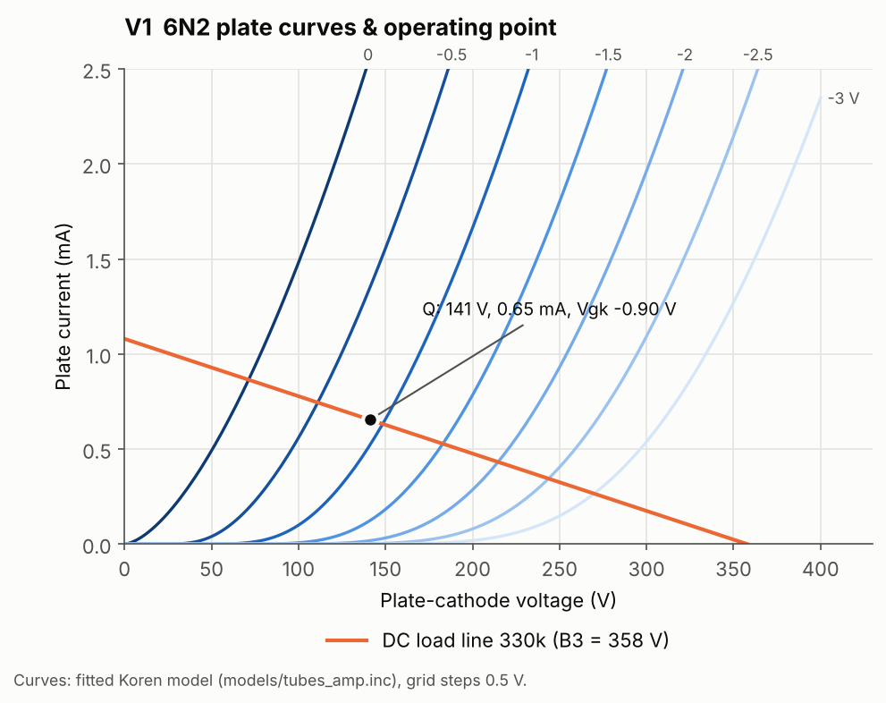 | 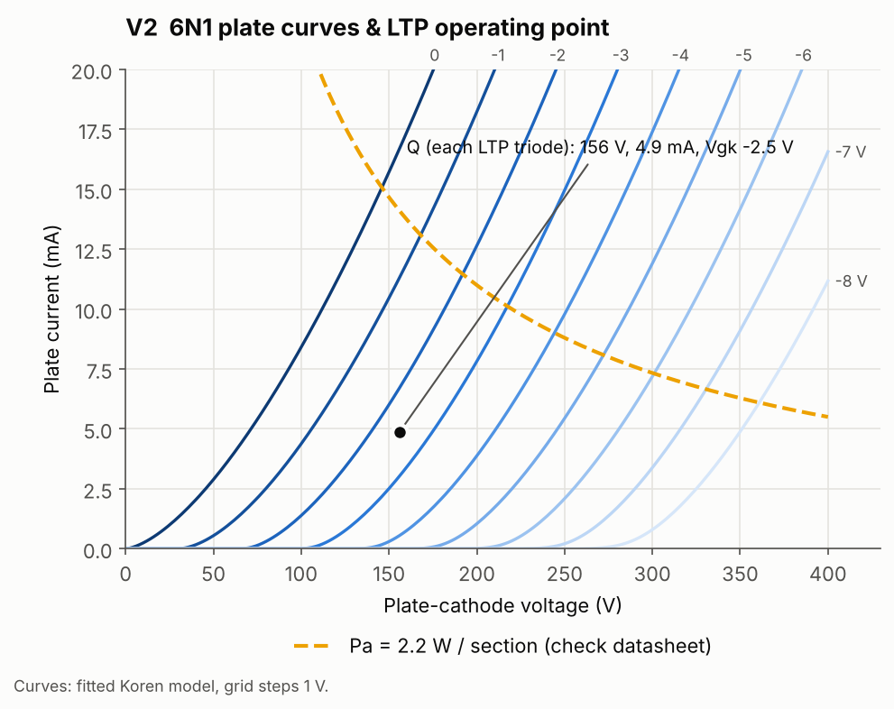 |
| 330k 負載線，Q 點 141 V / 0.65 mA，偏壓約 −0.9 V。直耦到長尾對，所以屏壓刻意壓低。 | 每邊 156 V / 4.9 mA，偏壓 −2.5 V，離屏耗上限很遠。 |

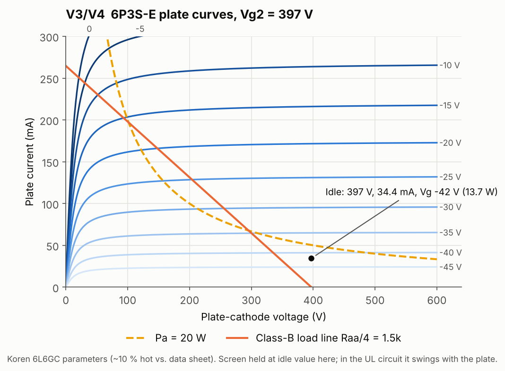

V3/V4 – 6P3S-E：靜態點 397 V / 34.4 mA（13.7 W，約額定 67 %），B 類負載線 Raa/4 = 1.5 kΩ。

#### 頻率響應與負迴授

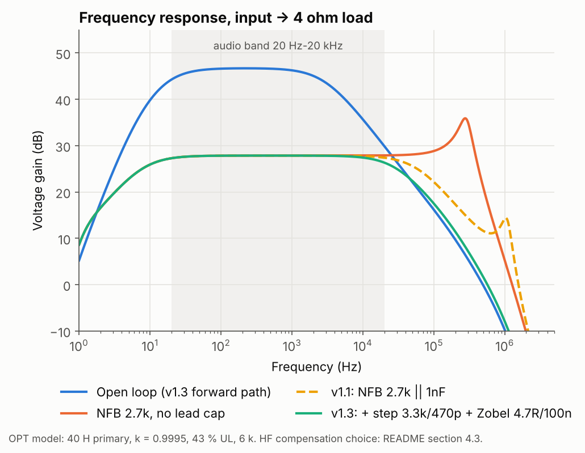

開迴路約 47 dB；加 2.7 kΩ 迴授後約 28 dB（約 20 dB 迴授）。只有迴授電阻時，約 300 kHz 有明顯的峰；v1.1 並聯 1 nF 相位超前電容後消除了這個峰，但約 1 MHz 仍有一個共振（虛線）。v1.3 再加上 6N2 屏極階梯網路與輸出端 Zobel，整條響應平滑下降，頻寬 7.4 Hz – 31.5 kHz。為什麼這樣選，見 §4.3。

#### 失真與輸出功率：固定偏壓 vs 自給偏壓

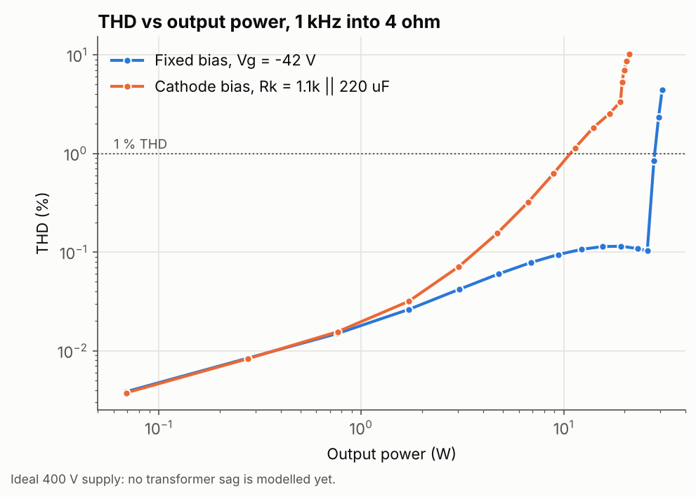

固定偏壓到約 25 W 前 THD 都在 0.1 % 左右，約 28 W 削波；自給偏壓約 11 W 就超過 1 %。這是本設計採用固定偏壓的主要依據。

#### 波形與驅動餘裕

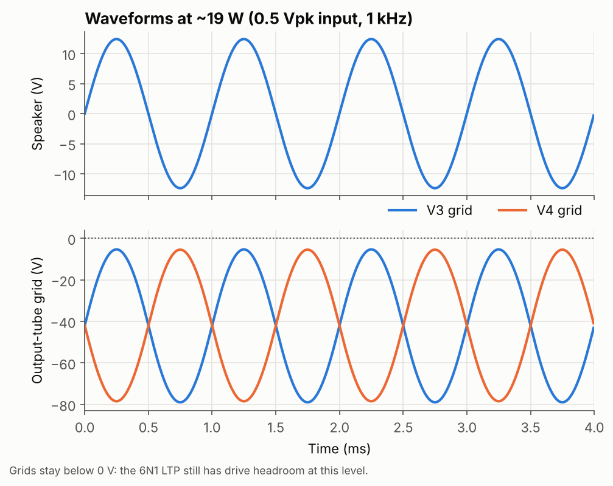

約 19 W 輸出時，兩支功率管柵極擺幅約 −80 ~ −5 V，仍未進入正柵，代表 6N1 長尾對還有驅動餘裕。

#### 偏壓掃描

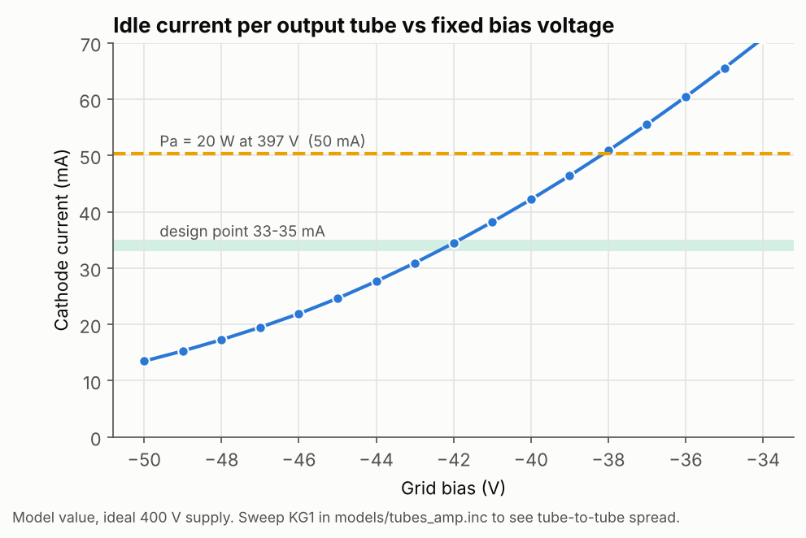

模型中 −42 V 對應 34 mA；約 −38 V 就會碰到 20 W 屏耗上限。

> ⚠️ 模型限制：§4.1 的圖用理想 400 V 電源；有電源壓降的結果見 §4.2。6L6 模型電流偏高約 10 %，OPT 與變壓器參數為假設值。

### 4.2 電源模擬（psu_v1）

電源電路、PSUD2 輸入表與電源單獨的掃描結果見 [`simulations/psud2/README.md`](simulations/psud2/README.md)。
這裡是把電源接上兩個完整聲道（`amp_stereo_psu_v1.cir`）後的結果。

#### 開機暫態

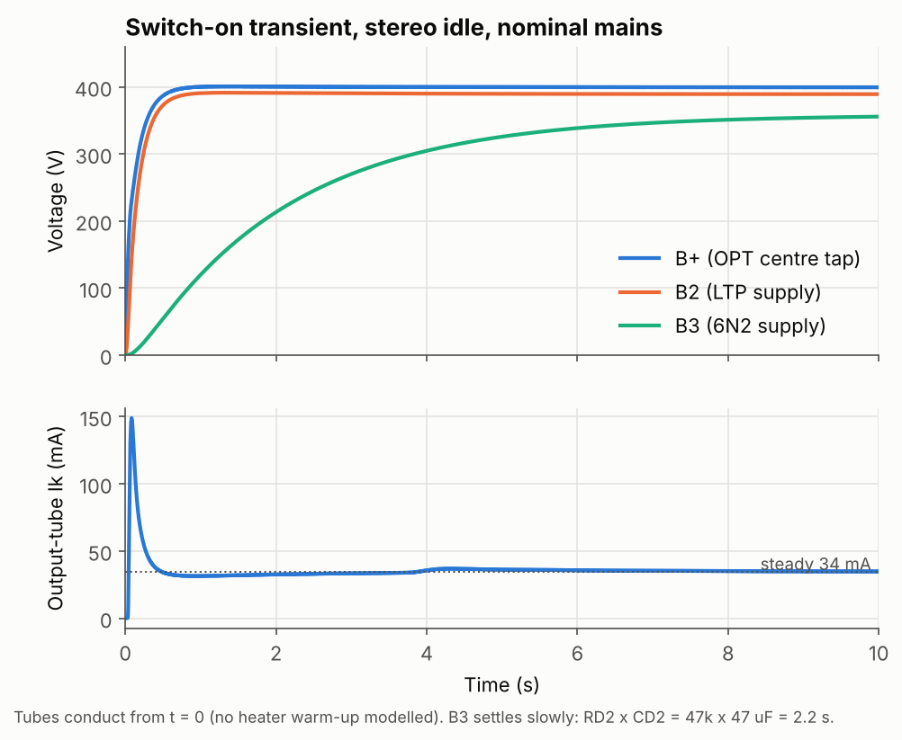

B+ 與 B2 約 1 秒到位；B3（6N2 電源）要 5–6 秒，因為 RD2 × CD2 = 2.2 s。開機約 0.1 s 時功率管電流有約 150 mA 的尖峰：B2 上升時經耦合電容把功率管柵極往正推。模型假設管子從 t = 0 就導通、偏壓瞬間建立，屬於最壞情況。

#### 漣波與哼聲

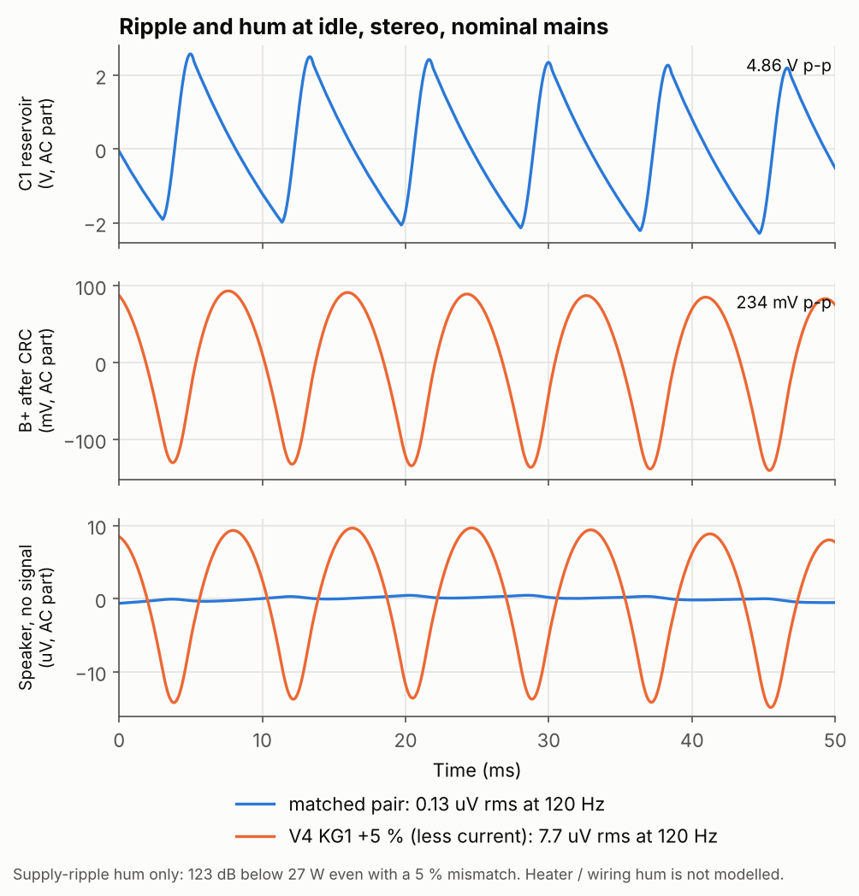

C1 漣波約 4.9 V p-p，經 CRC 後 B+ 剩約 0.23 V p-p。推挽把 B+ 漣波幾乎完全抵消：兩管匹配時喇叭端只剩 0.13 µV rms；一支管子電流少 5 % 時升到 7.7 µV rms，仍比 27 W 低約 123 dB。（只計電源漣波造成的哼聲。）

#### 失真與壓降

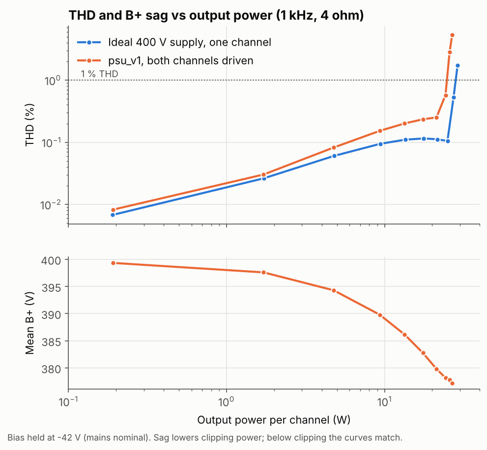

兩聲道同時滿載時 B+ 從 400 V 降到約 377 V，削波點從約 28 W 降到約 25 W／聲道；削波前的失真約 0.1–0.2 %，和理想電源差不多。

#### 市電 ±10 %：偏壓是否跟著變動

| 市電 | 偏壓 | B+ | 每管 Ik | 每管 Pa |
|---|---|---|---|---|
| 99 V | 隨市電（−37.8 V） | 360 V | 30.4 mA | 10.9 W |
| 99 V | 固定 −42 V | 368 V | 20.8 mA | 7.6 W |
| 110 V | −42 V | 400 V | 34.8 mA | 13.8 W |
| 121 V | 隨市電（−46.2 V） | 439 V | 39.3 mA | 17.2 W |
| 121 V | 固定 −42 V | 429 V | 51.4 mA | **21.9 W** |

偏壓若由同一顆變壓器的繞組供應，會跟著市電一起變大，市電 +10 % 時屏耗只到 17.2 W；若偏壓固定不變，則會到 21.9 W，超過 6P3S-E 的 20.5 W 額定。所以這個設計的偏壓電源模型必須隨市電變動（立體聲網表預設如此）。

> **v1.2（2026-11-02）**：取代 v1.1 中「B+ 420 V 時屏耗 18.7 W」的估算：那是理想電源加固定偏壓的結果，現在由上表（真實電源）取代。

### 4.3 B+ 與 OPT 敏感度

單聲道網表（理想 B+）中可調的參數：`VBPLUS`（B+）、`RAA`（OPT 初級阻抗）、`TU`（UL 抽頭）、`LH`（半邊初級電感，總電感 = 4 × LH）、`KC`（耦合係數）。數據都存在 `docs/data/*.csv`。

#### B+ 360–440 V

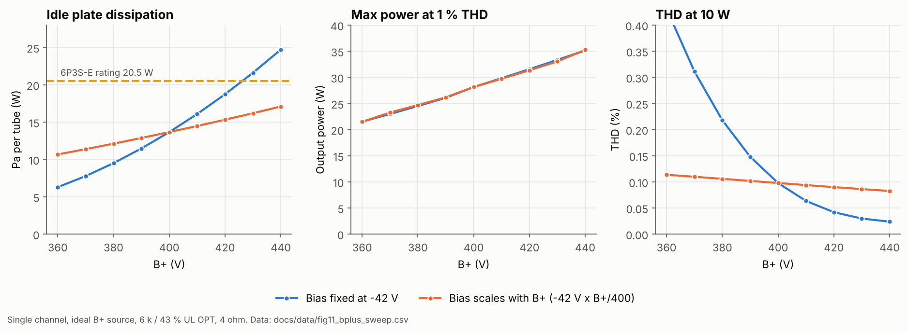

| | 偏壓固定 −42 V | 偏壓隨 B+ 等比例變動 |
|---|---|---|
| 靜態屏耗 360 → 440 V | 6.3 → **24.7 W**（約 426 V 起超過 20.5 W） | 10.7 → 17.1 W |
| 1 % THD 最大功率 | 21.5 → 35 W | 21.5 → 35 W |
| 10 W 時 THD | 0.43 → 0.02 % | 0.11 → 0.08 % |

最大功率幾乎只由 B+ 決定（每 10 V 約 +1.8 W），與偏壓方式無關；偏壓方式決定的是靜態屏耗是否安全，以及低 B+ 時的失真（偏壓固定時 B+ 一低，靜態電流掉到 18 mA，交越失真上升）。結論與 §4.2 的市電掃描一致：偏壓必須隨 B+ 變動。

#### OPT 初級阻抗 × UL 抽頭

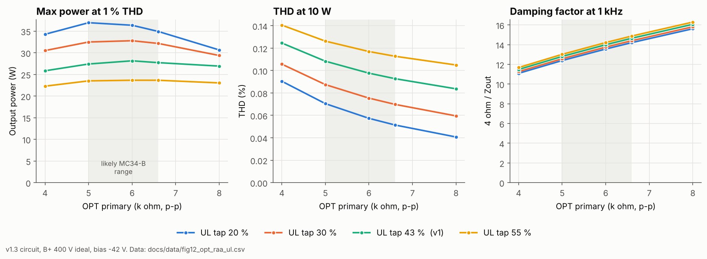

- **初級阻抗 5–6.6 kΩ（MC34-B 可能範圍）內結果很平**：43 % UL 時最大功率 27–28 W、10 W 失真 0.09–0.11 %、阻尼因數 13–15。所以 OPT 實際是 5 k 還是 6.6 k，對設計影響不大。
- **UL 抽頭影響比初級阻抗大**：抽頭越低越接近五極接法，功率越大（20 %：約 35–37 W；55 %：約 23 W），而且因為開迴路增益較高、迴授較深，失真反而更低。
- 阻尼因數主要隨初級阻抗上升（4 k：約 11–12；8 k：約 16），UL 抽頭影響很小。
- 在 v1.3 的高頻補償下，這 20 個組合全部沒有高頻峰。

#### OPT 初級電感與漏感：迴授穩定度

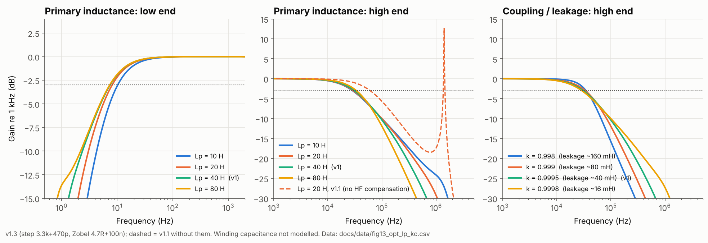

- **低頻**：初級電感 10–80 H，−3 dB 下限在 7–10 Hz，沒有任何低頻峰，低頻端很穩。
- **高頻（v1.3）**：−3 dB 上限在 29–35 kHz，所有組合都沒有峰值。

**高頻穩定度是怎麼決定的**

v1.1（只有 2.7 k ∥ 1 nF 迴授）的迴路在約 1 MHz 附近有窄共振，某些 OPT 組合會被推到 0 dB 以上，代表接近振盪。例如初級電感 20 H 時，1.41 MHz 處有 **+12.6 dB**（上圖中間虛線）。真實 OPT 參數未知，所以補償必須對所有可能的 OPT 都有效。做法是在 OPT 參數網格上找每種補償方案的最壞情況：

| 補償方案 | 120 組網格：最壞高頻峰 | 頻寬 (−3 dB) |
|---|---|---|
| 無（v1.1） | **+19.5 dB** | 61 kHz |
| 只加 Zobel 4.7 Ω + 100 nF | **+11.8 dB** | 61 kHz |
| 只把 CFB 改為 470 pF | **+25.3 dB** | 131 kHz |
| 只加 6N2 屏極階梯網路 4.7 k + 470 pF | +4.6 dB | 29 kHz |
| 階梯網路 4.7 k + 470 pF ＋ Zobel | −0.1 dB | 30 kHz |

再用 1440 組的密集網格（初級阻抗 4–8 k、UL 20–55 %、初級電感 16–60 H、耦合係數 0.998–0.9998）比較幾種階梯網路（都搭配 Zobel）：

| 階梯網路 | 100 kHz 以上最壞峰值 | 5–100 kHz 最壞隆起 | 20 kHz 響應 |
|---|---|---|---|
| 4.7 k + 220 pF | −0.3 dB（裕度太小） | +0.33 dB | −0.8 dB |
| 4.7 k + 470 pF | −0.7 dB | +0.31 dB | −1.65 dB |
| **3.3 k + 470 pF（v1.3）** | **−9.2 dB** | +0.47 dB | −1.5 dB |
| 2.2 k + 470 pF | −9.3 dB | +0.64 dB | −1.4 dB |
| 6.8 k + 330 pF | **+18.8 dB** | +0.23 dB | −1.25 dB |

結果對元件值很敏感（6.8 k + 330 pF 反而更差），所以 v1.3 選擇裕度大、5–100 kHz 隆起又小的 **3.3 kΩ + 470 pF**，搭配輸出端 Zobel 4.7 Ω + 100 nF。代價是頻寬從約 61 kHz 降到約 31 kHz（20 kHz 處 −1.5 dB）。

> 模型沒有包含 OPT 繞組分布電容，共振的頻率與高度只供參考；結論是「這個迴路需要高頻補償，而且要對 OPT 參數有足夠裕度」。

> **v1.3（2026-11-03）**：加入 6N2 屏極階梯網路 3.3 kΩ + 470 pF（`RSTEP`、`CSTEP`）與輸出端 Zobel 4.7 Ω + 100 nF（`RZOB`、`CZOB`），所有圖表與數據已重新產生。要回到 v1.1 比較，設 `RSTEP=1e9 RZOB=1e9`。

## 5. 目錄結構

```
mc34b-mod/
├── models/                 SPICE 模型 (tubes_amp.inc)
├── simulations/
│   ├── ltspice/            amp_channel_v1.cir（單聲道）、psu_v1.cir（電源）、
│   │                       amp_stereo_psu_v1.cir（自動產生，勿手改）、curves_*.cir
│   └── psud2/              PSUD2 輸入表 (README.md) 與 .psu 檔
├── docs/
│   ├── datasheets/         真空管 datasheet（擬合 / 檢查模型用）
│   ├── figures/            模擬圖表（tools/make_figures.py 產生）
│   └── data/               掃描結果 CSV（與圖同時產生）
├── tools/                  make_figures.py（重新產生 docs/figures）
├── setup-repo.ps1          一鍵建立目錄結構
├── .gitignore
└── README.md
```

## 6. 如何執行模擬

1. 用 LTspice 開啟 `simulations/ltspice/amp_channel_v1.cir`（File → Open，檔案類型選 All Files），按 **Run**。
2. 波形視窗加入 `V(out)`；THD 與功率結果在 **View → SPICE Error Log**。
3. 參數都集中在網表上方的 `.param` 區塊；可用 `.step param VB list -38 -42 -46` 掃描偏壓，或 `.step param KC list 0.998 0.9995` 掃描 OPT 耦合係數。
4. 要看直流工作點，在 `.tran` 前加 `.op`。屏耗 = V(pa) × V(ka)（RKO = 1 Ω，V(ka) 的數值即陰極電流）。
5. `curves_*.cir` 用來畫各管的屏極特性曲線，檢查模型是否合理。
6. `psu_v1.cir`：電源單獨模擬（定電流負載，與 PSUD2 相同）。改 `ILOAD`、`MAINS` 看不同情境。
7. `amp_stereo_psu_v1.cir`：電源 + 兩個聲道。它由 `python tools/make_figures.py stereo` 從前兩個檔案產生，要改電路請改來源檔再重新產生。冷機開機模擬請加 `.options method=gear`，並拿掉 `.ic` 行。
8. 功率管不匹配：`amp_channel_v1.cir` 中的 `KGA`、`KGB` 分別是兩支功率管的 KG1。
9. 敏感度：`VBPLUS`、`RAA`、`TU`、`LH`、`KC` 都在 `amp_channel_v1.cir` 的 `.param` 中，可用 `.step param RAA list 5k 6k 6.6k` 這類語法掃描。
10. 只重畫敏感度圖（不重跑模擬）：`python tools/make_figures.py plot11 plot12`。

**重新產生圖表**（需要 [ngspice](https://ngspice.sourceforge.io/) 與 Python 的 numpy、matplotlib）：

```powershell
pip install numpy matplotlib
python tools/make_figures.py            # 全部
python tools/make_figures.py fig4 fig5  # 只更新部分
```

## 7. 待辦（模擬）

- [x] 電源模型 psu_v1（SPICE），接上立體聲網表；B+ / B2 / B3、漣波、壓降、開機暫態
- [ ] 在 PSUD2 依 `simulations/psud2/README.md` 輸入並存成 `psu_v1.psu`，與 SPICE 結果對照
- [x] 市電 ±10 % 敏感度（含偏壓是否隨市電變動）
- [ ] 偏壓電源本身的模型（目前為理想電壓源 × MAINS）
- [x] B+ 360–440 V 敏感度（偏壓固定 vs 隨 B+ 變動）
- [x] OPT 敏感度：初級阻抗、UL 抽頭、初級電感、耦合係數
- [x] 高頻補償併入 v1.3（階梯網路 3.3 k + 470 pF、Zobel 4.7 Ω + 100 nF），全部圖表重新產生
- [ ] 在 OPT 模型加入繞組分布電容，重新檢查 1 MHz 附近的共振
- [ ] 方波 / 步階響應、開迴路增益與相位裕度（Middlebrook 或斷迴路法）
- [ ] 以 `KGA` / `KGB` 系統性掃描推挽兩管不匹配（失真、直流偏磁），以及 6P3S-E 與 6P3P 的差異
- [ ] 建立 LTspice 圖形化電路圖（`.asc`）

## 8. Commit 慣例

```
feat(sim):    新增 / 修改模擬
fix(model):   修正 SPICE 模型
docs(fig):    更新圖表或說明
chore:        目錄、設定等雜項
```

## 9. 參考

- N. Koren, *Improved vacuum tube models for SPICE simulations*（6L6GC / 12AX7 參數）
- Mullard, *Circuits for Audio Amplifiers*（5-20 直耦長尾對架構）
- [Elac ELT 10 – HiFi-Wiki](https://hifi-wiki.com/index.php/Elac_ELT_10)
