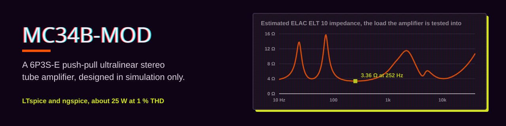
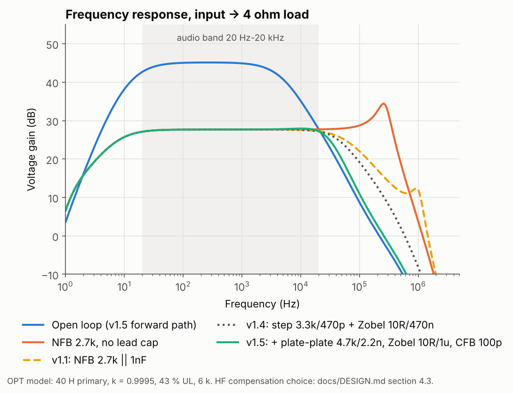
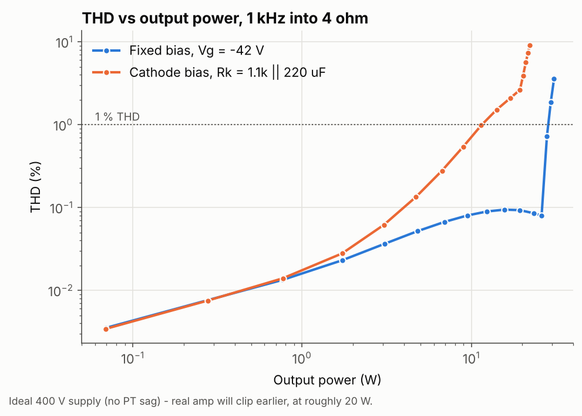
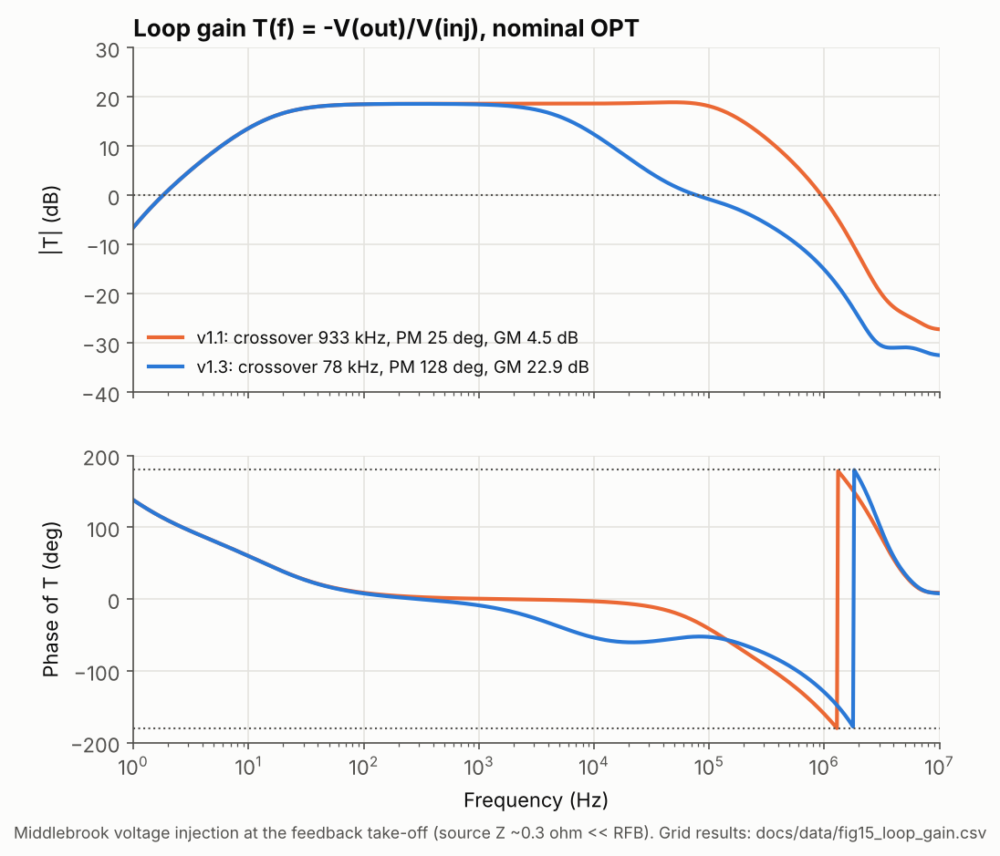
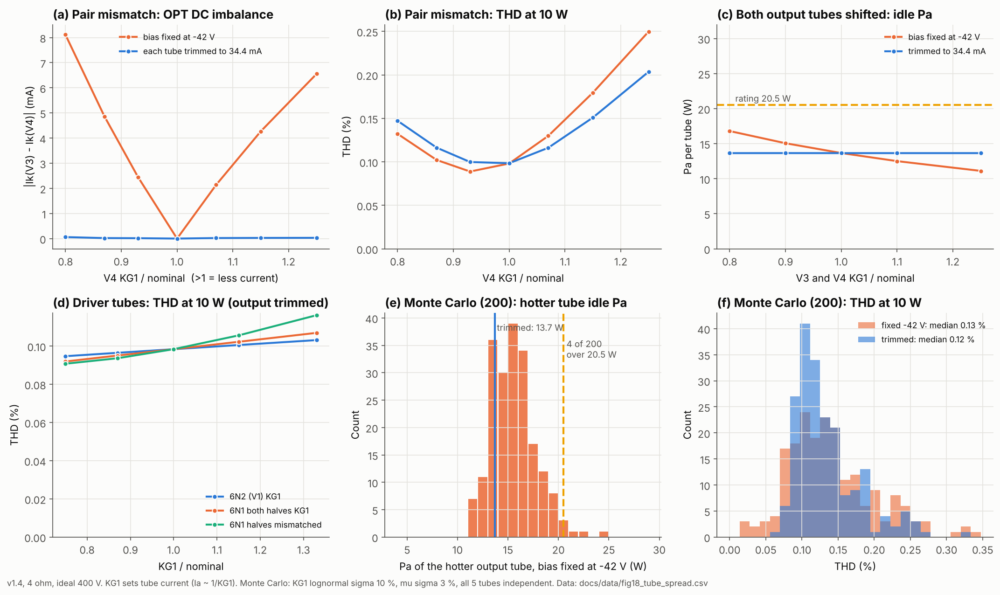
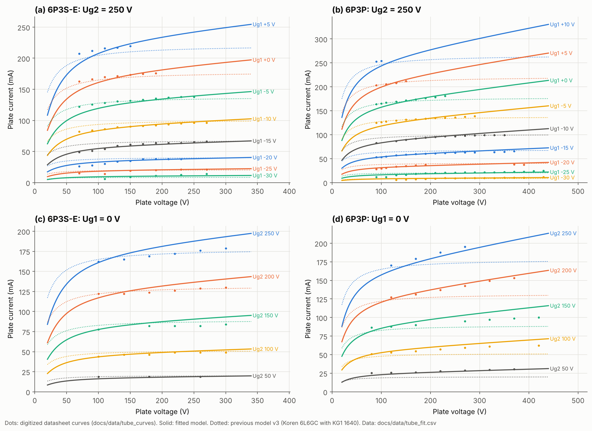

<p align="center">
  <picture><source media="(prefers-color-scheme: dark)" srcset="assets/banner-dark.svg"></picture>
</p>

# mc34b-mod

[English](README.md) · **繁體中文**

> **純模擬專案。** 以 Ming-Da MC34-B 的變壓器規格為假設條件，在 LTspice / ngspice（之後加上 PSUD2）中設計並驗證一台
> **6P3S-E 推挽超線性 (UL)、固定偏壓** 的立體聲真空管擴大機，負載為 **ELAC ELT 10**（4 Ω / 91 dB）。
> 本 repo 不包含任何實機製作內容。

[](https://github.com/heinricitorgau/mc34b-mod/actions/workflows/ci.yml)


用做模型的方式設計一台真空管擴大機：每個零件值都來自網表，每張圖都來自腳本，每個結論都來自掃描。電路是 6N2 電壓放大，直接耦合到 6N1 長尾對，再推動兩支 6P3S-E 推挽。變壓器、輸出變壓器與喇叭的數值都是假設或估計，文中皆有標明。

---

## 結果一覽

### 1. 基準：1 % THD 下 24 W，7.6 Hz – 32 kHz

以理想 400 V 電源、4 Ω 負載模擬（基準 v1.5）：增益 24.2 倍、頻寬 7.6 Hz – 32 kHz、阻尼因數 11.6、10 W 時 THD 0.28 %、1 % THD 時約 24 W，負回授約 20 dB。每支功率管靜態 34.4 mA、13.7 W，約為額定值的 67 %。CI 在每次變更時都會重新量測這些數字。

<p align="center"></p>

### 2. 為什麼用固定偏壓：24 W 對 9 W

固定偏壓下，失真在約 23 W 以前都低於 0.33 %，約 24 W 時達到 1 %。同一級改用陰極（自給）偏壓，約 9 W 就超過 1 %。

<p align="center"></p>

### 3. 在模擬中發現振盪，並把它設計掉

第一個有補償的版本（v1.1）接 4 Ω 看起來沒問題，不接負載卻會振盪。在 120 組輸出變壓器假設的網格上量測迴路增益後，才看出問題有多嚴重；經過三次改版把它修好：

| 120 組 OPT 的最壞情況，4 Ω | 最低相位裕度 | 最低增益裕度 |
|---|---|---|
| v1.1 | 0° | −12.1 dB |
| **v1.5** | **50°** | **37.7 dB** |

代價也一併寫明：頻寬由 47 kHz 降到 32 kHz，而且只接 2 µF 純電容負載時，增益裕度只有 2.7 dB。

<p align="center"></p>

### 4. 用真實電源、市電變動與 200 組不匹配的管子檢驗

- **電源壓降**：兩聲道滿載時，B+ 由 400 V 降到約 379 V，1 % THD 的功率由每聲道約 24 W 降到約 21 W。
- **市電 +10 %**：偏壓固定不動時，屏耗達到 21.0 W，超過 6P3S-E 的 20.5 W 額定值；偏壓取自同一顆變壓器時只到 17.0 W。所以偏壓必須跟著市電走。
- **管子離散**：在 200 台模擬的擴大機中，結果顯示每支管子都需要獨立調整偏壓，而且每支管子的可調範圍至少要涵蓋 −36 V 到 −50 V。

<p align="center"></p>

### 5. 管子模型依 datasheet 曲線擬合，並寫明其限制

功率管模型是依數位化的 datasheet 屏極曲線擬合（6P3S-E 91 點、6P3P 129 點），而不是由 6L6GC 縮放而來。這讓預測的失真比先前的單點模型高了約 3 倍，文件中照實寫出；這個結果對截止區很敏感，而那正是 datasheet 最難讀準的地方。

<p align="center"></p>

---

## 快速開始

用 LTspice 開啟 `simulations/ltspice/amp_channel_v1.cir` 並按 **Run**；或用 [ngspice](https://ngspice.sourceforge.io/)（38 以上）從命令列檢查整個基準：

```bash
pip install numpy matplotlib
python tools/ci_check.py            # 網表、電路圖、主要數字、穩定度：約 30 秒
python tools/make_figures.py fig4   # 重新產生一張圖
```

---

## 文件

| | |
| --- | --- |
| [**設計與模擬結果**](docs/DESIGN.zh-TW.md) | 模擬目標、電路架構、假設條件、v1.5 設計值，以及全部十項研究：電源、敏感度、穩定度、喇叭負載、管子離散、偏壓電源、繞組電容、管子擬合、鐵心飽和 |
| [**執行模擬**](docs/USAGE.zh-TW.md) | 目錄結構、各個網表與其參數、重新產生圖表、commit 慣例 |
| [電源與 PSUD2 輸入表](simulations/psud2/README.md) | 電源單獨模擬 |
| [待辦事項](TODO.md) · [貢獻指南](CONTRIBUTING.md) | 還沒完成的工作，以及如何提出修改 |

---

## 引用

要引用這份作品，請使用 GitHub 側欄的 **Cite this repository** 按鈕，它讀取的是 [`CITATION.cff`](CITATION.cff)。

## 授權

[MIT](LICENSE)。
